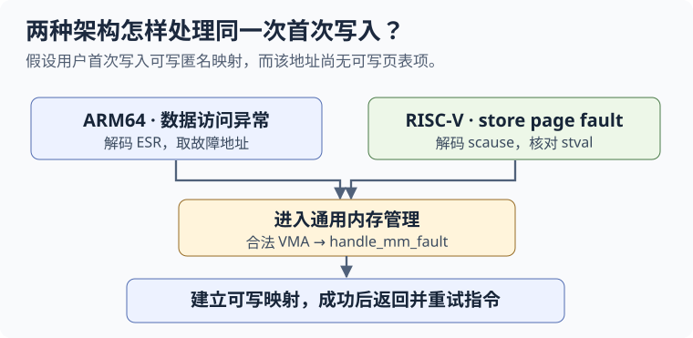

# 05 · 走进 ARM64 处理器

**第 15–19 周 · RK3576 真板，K230 架构对照 · 目标：连接指令执行、异常、地址转换与多核系统。**

## 先分清四层

**架构**定义软件可见的规则；**CPU 微架构**实现流水线、执行和缓存等；**SoC**集成 CPU、内存控制器和外设；**开发板**增加存储、供电与连接。AArch64、Cortex-A72、RK3576、某块 RK3576 板分别位于这些层次。

不要把 Cortex 核的数据手册当成 Rockchip 外设寄存器手册，也不要用 QEMU virt 的地址去操作 RK3576。

## 第 15–16 周：异常级与启动

学习通用寄存器、PC/SP、PSTATE、系统寄存器与异常向量，区分同步异常、IRQ、FIQ、SError。EL0–EL3 是权限与功能框架，不是所有系统都会把每级都以同一种软件布局使用。普通应用通常在 EL0，常见内核运行在 EL1；虚拟化或 VHE 等配置需要另查。

保存 RK3576 正常启动的串口日志，查找内核版本、CPU 和控制台初始化。想在第一行日志前停住内核时，可用 [L06](lab-qemu.md) 在 QEMU 中单步。从 `arch/arm64/kernel/head.S` 追到 `start_kernel`，标记进入内核时的启动协议、页表准备、栈与 MMU 状态。区分 Boot ROM、固件、引导加载器和 Linux 自身负责的工作。

### 跟一条用户指令进内核

假设用户程序在 EL0 调用 `read`。C 库把系统调用号、参数放进约定寄存器并执行 `svc` 指令；处理器按异常向量进入内核，入口代码保存用户现场，分派到系统调用实现。返回时恢复现场，应用得到返回值。串口收到字节则是另一条路径：设备发出 IRQ，中断控制器路由给 CPU，即使当时 CPU 在执行无关程序，也能进入对应中断入口。

看启动汇编或异常现场时，`PC` 表示当前指令位置，`SP` 指向当前栈，`PSTATE` 描述执行状态。以常见 EL0→EL1 同步异常为例，`ELR_EL1` 提供异常返回位置，`ESR_EL1` 提供异常类别等信息；发生数据访问异常时，还应结合 `FAR_EL1` 的有效性解释出错地址。先问「哪条指令出了什么事」，再看寄存器；异步 IRQ 通常要从中断控制器取得中断号。

启动是第三条独立路径。Boot ROM 找到可执行的初始装载代码，平台固件准备必要硬件，引导程序装入内核和 DTB，Linux 从自己的早期入口开始建页表、准备栈，随后进入 `start_kernel`。串口上第一条 Linux 打印晚于架构入口。可以用固件日志与 Linux banner 分段，再用 QEMU 的启动断点补看那些没有打印的步骤。

## 第 17 周：MMU 与 TLB

[](figures/trap-path.svg)

沿 ARM64 一侧追到通用处理，再回到同一条用户指令。对照 K230 时，替换上半段的架构入口。

学习页粒度、VA/PA、页表项权限与属性、TTBR、TCR、MAIR 的职责。先按选定配置推演一条 VA 的索引与偏移，再核对实际页大小和地址位数；不能默认所有 ARM64 系统都是 4KB 页和相同页表层数。

MMU 执行地址转换与权限检查，TLB 缓存转换结果。修改页表后的同步与 TLB 维护有架构规则；TLB miss 和 page fault 不是同义词。源码入口：`arch/arm64/mm/`、`arch/arm64/include/asm/pgtable*.h`。

### 手算一个用户地址的页内偏移

先用 `getconf PAGESIZE` 确认本次运行环境的基本页大小。下面只演算 4 KiB 页、48 位虚拟地址、四级转换且走到最后一级页表的情形。每张页表容纳 512 个 8 字节表项，因此一级索引用 9 位，页内偏移用 12 位。假设待翻译的虚拟地址 VA 为 `0x40203123`。

```bash
# 用一个具体的虚拟地址练习拆位。这里假设 4 KiB 页、48 位地址、四级页表。
va=$((0x40203123))
# 从高位到低位分别右移 39、30、21、12 位；与 511 保留该级的 9 位索引。
# 最后与 4095 取得低 12 位页内偏移，不需要访问真实页表。
printf 'L0=%d L1=%d L2=%d L3=%d offset=0x%x\n' \
  "$((va >> 39 & 511))" "$((va >> 30 & 511))" \
  "$((va >> 21 & 511))" "$((va >> 12 & 511))" "$((va & 4095))"
```

在使用 64 位整数运算的 shell 中，结果为 `0, 1, 1, 3`，偏移 `0x123`。MMU（内存管理单元）从相应页表基址出发，逐级沿表项寻找最终描述符。假设它允许本次访问，输出的物理页基址为 `0x81000000`，物理地址就是 `0x81000123`。这个物理基址是教学假设，无法从用户指针数值反推。若板上显示 16 KiB 或 64 KiB 页，先重新算偏移位数，再查该配置的页表层级。

**自测一：** TLB 中没有这条映射，必然进入内核吗？若页表有效且权限满足，硬件可遍历页表并缓存转换。缺映射或权限不允许才会引起相应异常。

**自测二：** 修改了页表映射，清理数据 Cache 就足够吗？数据 Cache 关联内存内容；TLB 缓存地址转换与权限。修改映射必须遵循内核对应的页表更新、屏障和 TLB 维护流程。

## 第 18 周：Cache、一致性、顺序

画出三张图：缓存层次；多核共享数据的一致性；软件要求的访问先后关系。Cache coherent 不能替代锁或内存屏障，也不能自动覆盖系统中每个 DMA master。区分指令/数据缓存、Normal/Device 内存属性与设备寄存器访问。

把“CPU 看到旧值”“设备看到旧缓冲区”“寄存器访问顺序错误”列为三个假设，分别寻找需要的同步机制。拓展阅读 DMB/DSB/ISB，但驱动优先使用 Linux 提供的 I/O、DMA 和锁接口，不能随手插一条屏障当通用修复。

### 为什么看得到标志，也可能读错数据？

设 CPU 0 先填好一份描述符，再把 `ready` 设为 1；CPU 1 看到 1 就读描述符。缓存一致性让各核对同一位置的写入逐渐取得一致视图；生产者还需让「填数据」先于「发布标志」对消费者生效。Linux 中一种典型配对是生产者对标志作 release 存储，消费者作 acquire 加载并确认读到了发布值。若设备参与传输，还需单独遵守该设备的 DMA 映射和同步协议。

遇到页表寄存器，先分清各自的职责：TTBR 给页表遍历提供起点，TCR 指定转换所用的地址大小、粒度等控制设置，MAIR 提供页表属性索引对应的内存类型。TLB 缓存转换结果；数据 Cache 缓存实际访问的内容。这样就能解释为什么改变某页的访问权限要维护转换缓存。

## 第 19 周：GIC、定时器与多核

理解本地与共享中断、IRQ 路由、CPU interface 与分发职责。通过实际 DTS 和配置核对 GIC 版本；PSCI 提供固件接口，参与 CPU 启停和电源管理；IPI 用于核间通知，它们与调度器分工不同。

源码入口：`drivers/irqchip/irq-gic-v3.c`（适用于匹配 GICv3 的平台）、`drivers/firmware/psci/`、`arch/arm64/kernel/smp.c`。对照 QEMU 生成的 DT 与 RK3576 的 DT，不复制硬件编号。

## 阶段验收

完成 [L10](lab-fault.md) 对照两种架构的异常入口，做 [L12](lab-k230.md) 区分固件、hart 和操作系统。交付启动日志、内核配置、一张异常入口图、一张 VA→PA 图、一张 GIC/CPU/设备图。能说明 syscall 和外设中断为何都能进入内核，但触发源与路径不同；能解释 Cache flush 与 TLB invalidate 的区别。

一手资料：[Arm A-profile 学习路径](https://www.arm.com/architecture/learn-the-architecture/a-profile)、[异常模型](https://developer.arm.com/documentation/102412/latest)、[内存管理](https://developer.arm.com/documentation/101811/latest)、[ARM64 启动协议](https://docs.kernel.org/arch/arm64/booting.html)。
