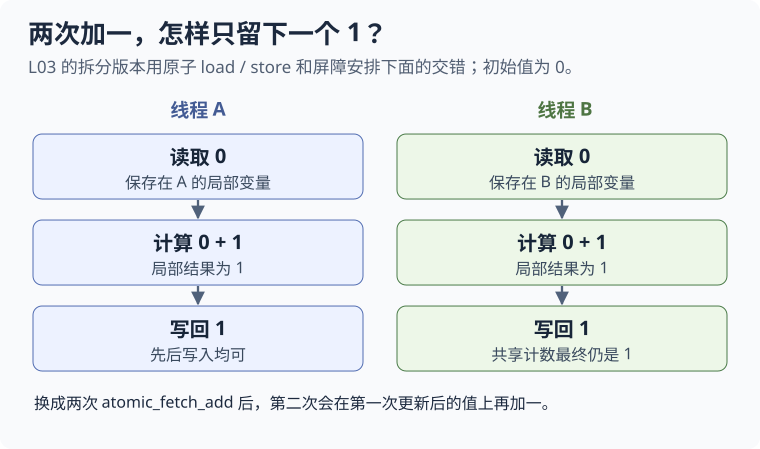

# 02 · 并发与中断

**第 5–7 周 · RK3576 上观察 IRQ 与并发，用 QEMU 补充内核调试。** 前置：任务状态与等待/唤醒。

## 第 5 周：先问“现在在哪个上下文”

区分任务上下文、硬中断、softirq、线程化中断和 workqueue。不要仅凭函数名判断是否允许睡眠，要结合调用路径、持锁状态与内核配置。普通 workqueue 的回调运行在工作线程中，也需要遵守自己的锁与生命周期约束。

先做上下文表，列出：由谁触发、能否被抢占、是否允许阻塞、共享对象如何保护。再在 RK3576 中观察 `/proc/interrupts` 与可用 trace 事件；WSL 没有开放相应功能时记录限制即可。

源码入口：`kernel/irq/`、`kernel/softirq.c`、`kernel/workqueue.c`。研究一个事件从 IRQ 到延迟处理的路径，暂不展开所有软中断类型。

## 第 6 周：锁保护的到底是什么

[](figures/lost-update.svg)

沿两列找出必须合在一起保护的步骤。临界区至少要覆盖从取得旧值到提交新值的整次更新。

先定义不变量，例如“队列中的元素数量与计数器一致”，再列出所有访问路径。单核也会发生抢占与中断并发；关闭本 CPU 的中断不能替代跨 CPU 的互斥。

完成[L03](lab-lock.md)。比较普通读改写、C 原子操作和互斥锁。用户态数据竞争实验不能用于推导 C 语言保证以外的行为。

内核中的 mutex、spinlock、raw_spinlock、原子操作、refcount、RCU 各有适用前提；不要背“一个永远睡眠、一个永远自旋”的绝对口号。**PREEMPT_RT 会改变部分锁类型的语义**，本阶段先按明确配置分析，再对照 RT 文档。参见[锁类型及规则](https://docs.kernel.org/locking/locktypes.html)。

### 用同一条队列判断该选哪种保护

假设设备队列同时保存链表和元素数，约定二者始终相符。若生产者先把元素入链，消费者在计数递增前进入，它会看到互相矛盾的数据。把计数改成原子变量只保证那一个变量的单次更新，无法把「入链、加数」合为同一次状态变化。

| 访问路径 | 先考虑什么 | 原因 |
| --- | --- | --- |
| 两个普通工作线程更新队列，允许睡眠 | mutex 覆盖整段更新 | 持有者可阻止另一个路径看到修改到一半的队列 |
| 普通内核配置中，硬 IRQ 和任务都访问短队列 | 按上下文选合适的自旋锁及本地 IRQ 保护 | 中断同核打断持锁者后再争同一把锁会互等；关本地 IRQ 也不能阻止另一核访问 |
| 最后一位使用者决定是否释放对象 | 引用计数加清晰的取还协议 | 引用计数管理寿命；队列内容的互斥仍需单独处理 |

如果回调必须等待耗时 I/O，可让硬中断只确认来源、记录事件，后续放到允许睡眠的上下文，再检查工作完成前对象是否仍存活。

## 第 7 周：事件、生命周期与可见性

把 waitqueue、completion、workqueue 分开：它们分别解决等待者组织、一次性/计数式完成通知、把工作交给工作线程等问题；都不能自动解决对象释放过早。重点分析取消工作、超时、设备移除与回调正在执行的竞态。

内存序解决访问顺序和可见性，原子性解决操作不可分割；它们不是同一个概念。`volatile` 不能当作线程同步。先用 acquire/release 的发布与消费模型理解，再读[内存屏障文档](https://docs.kernel.org/core-api/wrappers/memory-barriers.html)。

## 把一次外设完成拆成三个上下文

设一个设备一次只接受一个请求。进程发起请求并等待，一个硬中断处理程序确认设备已完成，一个工作线程负责可能睡眠的收尾。IRQ 是硬件中断请求，workqueue 是把工作交给内核工作线程执行的机制。先在有对应设备的板上只读采两次中断计数。

```bash
# 先保存业务开始前的每 CPU 中断计数。
cat /proc/interrupts > irq.before
# 此时运行一次这个设备已经验证过的正常业务
# 业务结束时再取快照，在 diff 中找目标 IRQ 的哪一列增长了。
cat /proc/interrupts > irq.after
diff -u irq.before irq.after
```

若目标 IRQ 一行的两个 CPU 计数从 `12 8` 变为 `12 10`，这一行增加了 2 次，新增计数出现在第二列对应的 CPU。计数属于中断线；共享 IRQ、后台业务或一次中断处理多个完成事件，都会影响它与请求的对应关系。目标行没变时先核对设备名、触发操作和驱动是否采用轮询。

`diff` 找到差异时退出码为 1，输出里还可能同时出现定时器和核间中断的增量。保留能对应到目标设备的行，并给每次采样记下业务起止时刻。

在纸上排列一次请求：提交前初始化完成通知；提交后等待；硬中断确认来源并记录状态；需要睡眠的操作交给工作线程；收尾完成后通知等待者。若一个普通请求锁已经由等待者持有，而工作线程必须拿它才能通知，两者就会互等。把等待移到解锁之后，再核对请求对象在整个期间都存活。

**自测一：** 能在普通硬中断回调里用 `mutex_lock` 等另一个线程吗？不能。硬中断上下文不能睡眠，必须重审共享状态和延迟处理边界。

**自测二：** 等待超时后可以立即释放请求对象吗？还要确认设备已停止访问，并与可能仍在执行的中断和工作线程完成同步。超时只说明等待者在期限内没等到通知。

## 一份锁审查记录

对一个队列写下：共享字段、读者、写者、执行上下文、锁顺序、允许睡眠的位置、引用从哪里获得和释放。然后人为加入“超时同时完成”和“设备移除同时回调”两个场景，检查是否遗漏路径。

源码入口：`include/linux/mutex.h`、`include/linux/spinlock.h`、`include/linux/completion.h`、`include/linux/refcount.h`。运行内核实验前启用可控 QEMU 的调试配置，错误实验不要放在日常工作环境或唯一可用开发板上。

## 阶段验收

能解释锁保护的不变量，指出一次丢失更新；能说明 wakeup、锁和内存屏障分别解决什么；能对一个 IRQ→workqueue→等待线程链路标注上下文与资源生命周期。给出锁顺序反例，并解释为什么加更多锁也可能导致死锁。

拓展方向：lockdep、KCSAN、RCU、优先级反转与 PREEMPT_RT。先做到能识别问题，再追算法与实现。
