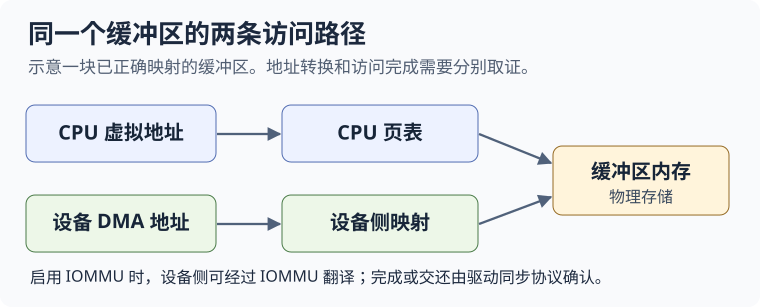

# 06 · 内核如何管理硬件

**第 20–23 周 · RK3576 实机 · 目标：把驱动接口与硬件资源、缓冲区生命周期连接起来。**

## 第 20 周：设备模型与设备树

复习 bus、device、driver、match、probe。设备树描述硬件及其连接，不直接执行初始化代码。`compatible`、`reg`、`interrupts`、`clocks`、`resets`、`power-domains`、`iommus` 等属性要按对应 binding 和父节点规则解释。

选一个已经工作的外设，画 DT 节点→平台设备→匹配表→probe→资源获取。源码入口：`drivers/base/`、`drivers/of/`、目标驱动；绑定文件在 `Documentation/devicetree/bindings/`。未知属性查 schema，不猜 cells 含义。

### 在当前板上找出一次真实绑定

`sysfs` 是内核向用户空间展示设备和驱动关系的文件系统。下面从已绑定的平台设备中选出有设备树节点的第一个。它只读取链接和字符串，适合不同板卡和不同地址布局。

```bash
# 遍历 platform 总线上的设备，筛出既绑定了驱动又提供设备树 compatible 的一个实例。
for d in /sys/bus/platform/devices/*; do
    [ -L "$d/driver" ] && [ -r "$d/of_node/compatible" ] || continue
    # 取设备目录名、驱动链接末级名称，配成一条实际的设备绑定记录。
    printf 'device=%s\n' "${d##*/}"
    printf 'driver=%s\n' "$(basename "$(readlink "$d/driver")")"
    # 一个 compatible 属性可能包含多个以空字符分隔的名字，转成多行后再与驱动匹配表比较。
    tr '\000' '\n' < "$d/of_node/compatible"
    # 只研究第一个符合条件的设备，在这一步结束遍历。
    break
done
```

在对应 BSP 源码用 `git grep -n -F '实际的兼容字符串' -- drivers` 找匹配表，从表所在驱动追 `probe`（设备绑定时的探测函数）。字符串列表可同时包含厂商专用名和通用回退名，源码也可能通过宏构造，第一次搜索无结果时逐项核对。记下 probe 中首次取得时钟或中断号的位置，再找启动该资源的位置；申请句柄和启动硬件可能在不同函数。若板上没有输出，检查平台总线、运行设备树和实际挂载的 sysfs，再改查该外设所属的 I²C 等总线。

**自测一：** 找到 `of_node` 就能断言可用吗？它表明设备树关联存在，`driver` 链接证明当前绑定，真实数据传输还要由一次成功业务或相应完成事件验证。

**自测二：** 出现 `-EPROBE_DEFER` 时反复加启动延时有用吗？先查 probe 正在申请哪一项供应资源，再检查提供者设备是否绑定。若内核提供 `/sys/kernel/debug/devices_deferred`，其条目可补充延期原因。

## 第 21 周：资源、IRQ 与电源

追踪资源何时申请、何时启用、失败如何回滚、移除时何时停止硬件。`devm_*` 帮助管理资源释放，但不能替代停止 DMA、取消异步工作或保证回调不再访问已释放对象。

整理 clock、reset、regulator、power domain 和 runtime PM 的依赖。检查 probe defer 的原因：依赖资源尚未可用，并不等于目标设备永久不支持。比较“有设备节点”“驱动绑定成功”“硬件真正工作”三种证据。

### 看一份驱动如何让设备从休眠中工作

以需运行时供电的控制器为例：驱动在 probe 阶段取得资源句柄；一次请求到来后由 runtime PM 协调恢复；厂商实现可能启用供电、时钟，解除复位，再配置寄存器并提交请求。时钟（clock）让电路接收节拍，复位（reset）控制逻辑是否保持初始状态，供电调节器（regulator）提供电压，电源域（power domain）控制一组硬件的供电状态。pinctrl 决定板上引脚被复用成哪种信号。具体顺序回到本机驱动与硬件手册核对。

反过来检查「驱动已绑定，却没有收到数据」：运行 DT 和 `driver` 链接帮助确认匹配，时钟和 PM 状态说明设备有无机会运行，真实输入和 IRQ/完成事件说明请求是否向前推进。每项证据解答的环节不同。

## 第 22 周：DMA 与地址

[](figures/dma-views.svg)

先用手指分别沿 CPU、设备两条箭头走一遍，再为目标驱动的每个地址标出使用者。

完成[L07](lab-dma.md)。把 CPU 虚拟地址、CPU 物理地址、设备 DMA 地址分别画出。IOMMU 存在并被使用时可提供设备侧地址转换；**DMA 地址不能普遍假设等于物理地址**。

比较 coherent 分配与 streaming mapping，标出 DMA 方向、mapping error、CPU/设备所有权转换与 unmap。Cache coherent 也不消除所有顺序要求。依据：[Linux DMA 指南](https://docs.kernel.org/core-api/dma-api-howto.html)。

## 第 23 周：DMA-BUF 与同步

DMA-BUF 是跨驱动/设备共享缓冲区的框架，围绕 exporter、importer、attach、map、CPU access 等角色理解。它不自动证明零拷贝、格式兼容或设备写入已完成。把缓冲区共享、设备地址映射、缓存维护、完成同步分别分析。

理解 dma-fence 与 dma-resv 在同步中的角色。源码入口：`drivers/dma-buf/`、`include/linux/dma-buf.h`、目标驱动实际调用点。参考：[DMA-BUF 文档](https://docs.kernel.org/driver-api/dma-buf.html)。

### 一帧图像如何交给另一个设备

假设解码器把帧写进一个 DMA-BUF，显示控制器随后读它。exporter 管理缓冲区底层存储，importer 为自己的设备建立 attachment 并映射，得到符合该设备地址约束的段。缓冲区 fd 负责让双方找到同一个共享对象。解码结束及写入可见还需要相应同步，显示侧才能开始读；显示仍占用帧时，解码器不能把它当空闲帧覆盖。

dma-fence 表示一次异步操作的完成状态，dma-resv 可将相关 fence 与共享缓冲区关联。画时序从「谁会写」「谁随后要读」「谁决定能复用」三个问题入手。看到一个 fd 或一个内存地址，尚缺少回答这三个问题的时间信息。

## 阶段交付

一份设备资源依赖图、一份 probe/失败/移除生命周期表、一份缓冲区提交与回收时序。每条 DMA API 都要能说出调用者、方向、有效期、失败处理与同步前提。

## 阶段验收

回答：为什么不能把 `malloc` 的指针写进设备寄存器；`devm` 是否意味着任何时刻都可直接退出；DMA-BUF fd 相同是否说明两个设备看到相同 IOVA；一次超时后立即释放缓冲区有什么风险。

可用下面的顺序对照答案。用户指针由当前进程的页表解释，设备需使用驱动通过 DMA API 为该设备取得的地址。同一个 DMA-BUF 被两个设备导入时，各自映射得到的 IOVA（设备侧虚拟地址）可能不同。驱动退出前须先停止设备和异步工作，再释放关联内存；仅靠 `devm` 或等待者超时都不能证明设备已停止。

代码实验先在可恢复的环境进行。板上寄存器读写、解绑驱动、改时钟或替换 DTB 都应先准备串口日志和恢复介质；本课程的首次实机实验以只读取证为主。
