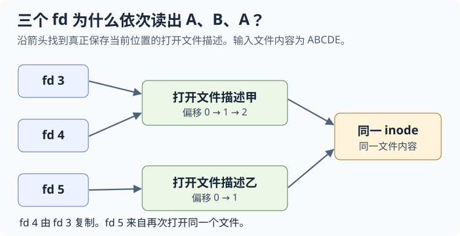

# 04 · VFS 与 I/O

**第 12–14 周 · RK3576 或 WSL2 · 目标：知道系统调用跨过了哪些对象与层次。**

## 第 12 周：fd 只是入口

文件描述符是进程文件表中的索引，不等于 inode，也不等于磁盘文件。打开文件描述对应内核的 file 对象；dentry、inode、superblock 各描述不同职责。`dup` 与 `fork` 后的文件偏移共享，需要沿对象引用关系分析。

用[L05](lab-io.md)观察 `openat/read/write/close`，再写一个 `dup` 后交替读的小程序，预测文件偏移。源码入口：`fs/open.c`、`fs/read_write.c`、`include/linux/fs.h`。参见[VFS 概览](https://docs.kernel.org/filesystems/vfs.html)。

### 用三个 fd 测出一个共享偏移

[](figures/shared-offset.svg)

从 fd 3 读完 A 后，在甲的框里把偏移改为 1，再沿 fd 4 的箭头看它将读到哪个字符。

在 Linux shell 中运行。`mktemp` 创建自己的临时文件，`dd` 每次从标准输入读一个字节。输出的三个字符之间没有换行，最后的 `printf` 统一换行。

```bash
# 创建独立临时文件，写下每个位置都不同的五个字节，方便凭字母判断偏移。
f=$(mktemp)
printf 'ABCDE' > "$f"
# fd 3 第一次打开文件。复制出的 fd 4 与 3 共享偏移；fd 5 再次打开，偏移独立。
exec 3<"$f"
exec 4<&3
exec 5<"$f"
# 三次各取一字节。3 取 A 并推进偏移，4 随后取 B，5 则从自己的开头取 A。
dd bs=1 count=1 <&3 2>/dev/null
dd bs=1 count=1 <&4 2>/dev/null
dd bs=1 count=1 <&5 2>/dev/null
printf '\n'
# 关闭 shell 中的三个描述符，然后删除这次创建的临时文件。
exec 3<&- 4<&- 5<&-
rm "$f"
```

预测是 `ABA`。fd 3 和 4 引用同一个打开文件描述，3 读完 A 后其偏移已经到 1，4 继续读到 B。fd 5 是一次新的打开，拥有从 0 开始的独立偏移。三者引用同一文件内容。若第二个也是 A，先检查第二步是否误写成 `exec 4<"$f"`，那会再次打开文件。用 `cat /proc/$$/fdinfo/3` 可在关闭前读取当前 `pos`。

**自测一：** 先关闭 3，4 还能读吗？能，4 仍持有这一打开文件描述的引用。关闭一个编号不会撤销其他引用。

**自测二：** 把输入改为管道，能否把读位置退回 0 重读 A？管道传递按顺序消费的数据，不支持普通文件的可定位偏移。VFS（虚拟文件系统）通过各对象的操作表分派同一套 fd 接口。

### 把一个文件名拆成三个对象

以两次打开同一个已存在的文件为例。路径查找会经过 dentry（目录项，把某个父目录下的名字关联到对象），inode（文件的身份、类型、权限等元数据）属于某个文件系统实例，superblock 表示该实例。每次独立 open 创建自己的打开文件描述，保存当前偏移和状态。两个 fd 因此可以对应同一 inode 又拥有不同偏移；`dup` 复制 fd 时则保留对同一打开文件描述的引用。

有了这张图再看删除：`unlink` 去掉一个目录中的名字。已经打开的 fd 仍持有引用，即使原来那条路径已经找不到，进程也可能继续读写文件。这解释了为什么「找不到文件名」和「没有程序在用其空间」是两件可分别观测的事。

## 第 13 周：缓存、块层与完成

普通文件的 buffered I/O 通常经过页缓存。应用的 write 返回不等于数据已经持久化到设备；`fsync`、文件系统、块层与存储硬件共同影响持久性语义。direct I/O 的条件、对齐和一致性另行分析，不能只把它理解成“更快”。

在 Linux 文件系统上的实验目录比较读写与 `fsync` 的系统调用时间。WSL 中 `/mnt/c` 和 Linux 文件系统可能走不同路径，实验先放在 `~/kernel-lab`，结论标记路径和环境。不要用简单热缓存测试代表实际磁盘吞吐。

源码入口：`mm/filemap.c`、`fs/` 中所用文件系统、`block/blk-mq.c`。先画分层图，再选一个请求追踪。块层细节见[块设备文档](https://docs.kernel.org/block/index.html)。

## 第 14 周：socket 也是 fd，但路径不同

运行本地 loopback socket 实验，观察 `socket/bind/listen/accept/connect/send/recv/poll`。对照管道的等待模型，说明“可读事件”是继续尝试读取的条件，不保证任意长度读取都会立即完成。

理解协议处理、缓冲队列与唤醒，不要求三周内读完 TCP。源码入口：`net/socket.c`、`net/ipv4/`、`fs/eventpoll.c`。接口参考：[socket(2)](https://man7.org/linux/man-pages/man2/socket.2.html)、[epoll(7)](https://man7.org/linux/man-pages/man7/epoll.7.html)。

## 阶段验收

画出 fd→file→具体 file_operations 的关系；解释普通文件、socket 与设备节点为何都能使用 fd，却不能共用一套内部路径；解释 buffered write 返回、设备完成和持久化之间的区别。

给出一份阻塞 I/O 的时序，把运行、等待事件、唤醒和返回分开。如果只看到 `strace` 时长，不能据此断言耗时全部发生在硬件上，需在综合阶段补充内核 trace。

延伸：网络协议栈、文件系统日志、io_uring、块调度策略。先掌握接口与对象边界，再选择支线。
