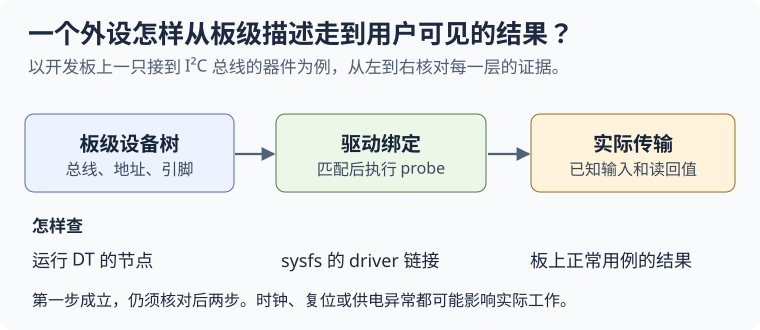

# L08 · RK3576 实机取证

**环境：手中的 RK3576 板 · 约 120 分钟 · 首轮只读。** 先确认串口与恢复资料可用，暂不刷机、不替换 DTB。

## 建立基本档案

```bash
# 保存发行版和正在运行的内核版本，再看本内核报告的 CPU 信息。
cat /etc/os-release
uname -a
cat /proc/cpuinfo
# model 是板名，compatible 是匹配字符串列表。把设备树的空字符换行再读。
tr '\000' '\n' < /sys/firmware/devicetree/base/model
tr '\000' '\n' < /sys/firmware/devicetree/base/compatible
# 记录各 CPU 的 IRQ 计数以及内核公布的物理资源范围，权限可能限制地址显示。
cat /proc/interrupts
cat /proc/iomem
```

有的文件受权限或内核配置限制；记录“不可读/未提供”，不要把空输出当硬件不存在。`/proc/iomem` 地址也可能被隐藏。日志使用 `dmesg` 或板上可用的 journal 接口，必要时通过 sudo 只读获取。

不要直接 `cat` 二进制 DT 属性来猜数值。model/compatible 是字符串；reg、interrupts 等需要按 DT 编码和 binding 解码。

## 导出与核对运行设备树

安装了 `dtc` 且内核提供导出目录时，可以运行：

```bash
# 从运行内核导出的设备树反编译，输出保存为 DTS，供后续按节点查属性。
dtc -I fs -O dts /sys/firmware/devicetree/base > running-board.dts
```

反编译可能出现警告，运行 DT 也可能经过 bootloader 修改。它不天然等于源码里某个 `.dts` 原文。记录原始 DTB/源码来源，并对照 model、compatible 与关键设备节点。

## 选择一个设备建立证据链

[](figures/rk-device.svg)

如果只在设备树里找到了节点，先填左边一格。等取得驱动链接和业务结果，再填写另外两格。

1. 找到 DT 节点和 `compatible`；
2. 通过 `/sys/bus/platform/devices/` 等对应总线确认设备与 driver 链接；
3. 在对应 BSP 的匹配表中找到字符串；
4. 确认 probe 日志或其他绑定证据；
5. 运行已知正常用例，对照 IRQ、错误日志与输出。

每一步分别记录。设备存在、驱动绑定和业务成功是三个不同层次。

## 实例：从启动控制台定位一个 UART

UART 是串行收发器。引导固件可以通过设备树的 `/chosen/stdout-path` 指定早期输出设备。Linux 运行后还可能受内核命令行 `console=` 和控制台驱动影响。在板上运行下面的只读步骤，分别取得固件描述和当前系统的证据。

```bash
# 从正在运行的设备树开始；chosen 指定的输出路径可能带冒号和串口参数。
dt=/sys/firmware/devicetree/base
if [ -r "$dt/chosen/stdout-path" ]; then
    # 去掉属性末尾的空字符，再取第一个冒号前面的路径或别名。
    out=$(tr -d '\000' < "$dt/chosen/stdout-path")
    name=${out%%:*}
    # 以斜杠开头就是完整路径，其余名字要到 aliases 下查找。
    case "$name" in
        /*) path=$name ;;
        *)  path=$(tr -d '\000' < "$dt/aliases/$name") ;;
    esac
    # 同时显示原始值和解析出的节点路径，便于发现别名解析失败。
    printf 'stdout=%s\nnode=%s\n' "$out" "$path"
    if [ -n "$path" ] && [ -r "$dt$path/compatible" ]; then
        # compatible 的每个空字符分隔项独占一行，用来和串口驱动匹配表对照。
        tr '\000' '\n' < "$dt$path/compatible"
    fi
fi
# 最后核对 Linux 实际登记的控制台，检查它和设备树给出的线索是否一致。
cat /proc/consoles
```

举例：若 `stdout-path` 为 `serial2:1500000n8`，冒号前的 `serial2` 是别名，应从 `/aliases/serial2` 得到节点绝对路径；冒号后是串口配置后缀。沿该路径读出的 `compatible` 才能拿去对照 BSP 的驱动匹配表。`/proc/consoles` 列出 Linux 已注册的控制台，把设备名与 `/proc/cmdline` 中的 `console=` 对照，并核对实际控制台输出。示例名称和速率均应由本板输出替换。

**自测一：** `stdout-path` 缺失，能否断言没有串口设备？不能。查看内核命令行、`/proc/consoles` 和板厂串口说明，再从运行设备树中选择已绑定的 UART。

**自测二：** 两块板报相同的 `uname -r`，可以复用其设备树吗？还要确认板型、版本、引脚连线、启动固件以及 DTB 来源。内核 release 字符串不能替代这些硬件和构建证据。

## SoC 地图最小内容

CPU 集群与核心、GIC、DDR、一个 IOMMU、一个媒体或外设设备、时钟与电源提供者。对每个连接写出来源：厂商文档、实际 DT、源码或观测。未知内容留空并写验证方法。

## 验收

提交不含敏感信息的板卡档案、运行 DT 对照、一个设备证据链和问题清单。能回答：当前使用哪个 BSP，哪些功能只是源码中存在，哪些已经被你实际验证。

不要把板卡序列号、MAC、网络凭据或厂商未公开资料直接提交到公开仓库。参考：[设备树使用模型](https://docs.kernel.org/devicetree/usage-model.html)。
