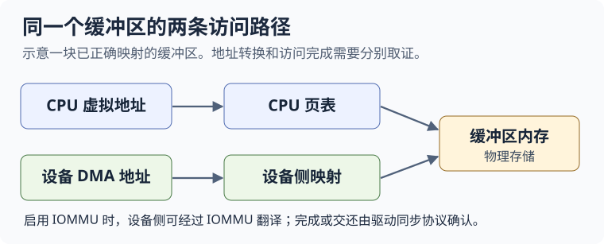

# L07 · DMA 地址与生命周期

**环境：RK3576 对应 BSP 源码，先静态阅读再实机观测 · 约 120 分钟。** 不直接操作寄存器，不通过猜地址验证。

## 选取一个真实调用点

先在对应 BSP 中搜索，可能因版本和驱动框架出现不同接口：

```bash
# 找驱动中建立一致性缓冲或流式映射的地方，保留行号便于顺着调用者阅读。
rg -n 'dma_alloc_coherent|dma_map_sg|dma_map_single' drivers
# 再找共享缓冲的附着、映射和 CPU 访问路径，选定一个实际驱动对照。
rg -n 'dma_buf_attach|dma_buf_map_attachment|dma_buf_begin_cpu_access' drivers
```

选择一个与板上已工作的设备有关的路径，记录设备、驱动、源码提交与配置。搜索命中不证明实际运行，一定要把 DT、绑定驱动和用例对上。

第一次阅读可从 Linux v6.12 的 SDHCI 存储控制器开始。这里能在同一文件里追到 scatterlist（分散在不同页上的多段数据）、设备描述符和解除映射。一份文件即使对用户连续，也可以由多段内存组成。进入[固定版本源码](environment.md)的根目录执行下面的只读查询。此例用来学习 API；板上是否执行它，留待后面的驱动绑定核对。[v6.12 SDHCI 实现](https://github.com/torvalds/linux/blob/v6.12/drivers/mmc/host/sdhci.c)

```bash
# 固定在同一 SDHCI 文件中追踪 scatterlist 从映射到解除映射的生命周期。
f=drivers/mmc/host/sdhci.c
# 先找谁建立或解除映射，再找谁使用返回的设备地址与长度填写描述符。
rg -n 'sdhci_pre_dma_transfer|dma_map_sg\(|dma_unmap_sg\(' "$f"
# COOKIE_PRE_MAPPED 是追踪预映射状态的搜索线索。
rg -n 'sg_dma_(address|len)\(|sdhci_adma_table_pre|COOKIE_PRE_MAPPED' "$f"
```

从 `sdhci_pre_dma_transfer` 的直接映射分支开始，在纸上抄出传入的设备、`data->sg_len`、数据方向和返回的 `sg_count`。如果返回 0，跟到失败返回处就停止；成功时再追哪些地址和长度被写进 ADMA 描述符。地图上另画出 bounce buffer 和预映射两个分支，避免把三个互斥条件拼成一次传输。

## 画两个地址视角

[](figures/dma-views.svg)

查驱动中的映射调用：返回给设备的地址填入下方，CPU 访问缓冲区使用的指针填入上方。

CPU 使用虚拟地址，经 CPU MMU 到物理地址；设备使用 DMA 地址，可能经 IOMMU 到物理内存。IOMMU 不存在或旁路时也不能不经 API 就假设总线地址等于 CPU 物理地址。具体关系由平台决定。

对每个变量标注类型：`void *`、`phys_addr_t`、`dma_addr_t`、sg_table、用户态指针或 fd。不要把 fd 当内存地址，不用 `virt_to_phys` 绕过 DMA API 的要求。

## 画一条所有权时间线

申请/导入 → 映射给设备 → CPU 填写或同步 → 提交 → 设备访问 → 完成事件 → CPU 再访问 → 解除映射/释放。真实顺序按 API 类型与方向核对，不机械套用每一步。

记录：谁负责 map/unmap；是否检查失败；是否可能多设备共享；何时允许 CPU 访问；超时/取消/移除后如何确保硬件不再访问；scatter-gather 映射前后条目数如何正确使用。

## 区分四个问题

| 问题 | 要找的机制 |
| --- | --- |
| 设备能够寻址这段内存吗？ | DMA mask、映射、IOMMU |
| CPU 和设备看见的数据正确吗？ | DMA API 的一致性/同步规则 |
| 设备是否已经处理完？ | IRQ、状态、fence 或驱动完成协议 |
| 对象是否还活着？ | 引用、队列状态、取消与释放顺序 |

## 实机观察与验收

如果板子使用 MMC，可先运行以下只读命令。`device/driver` 指向该主机控制设备所绑定的驱动，`compatible` 帮你在匹配版本的 BSP 源码中定位 DT 匹配表。无匹配时，保留上游阅读记录，换板上实际启用的控制器继续。找不到这些节点也可能是本次镜像从其他类型的存储启动。

```bash
# 枚举本机注册的 MMC 主机，并跳过没有对应 device 的条目。
for host in /sys/class/mmc_host/mmc*; do
    [ -e "$host/device" ] || continue
    printf '%s\n' "$host"
    # 沿链接找实际绑定的驱动。
    readlink -f "$host/device/driver"
    # 设备树属性可读时，把以空字符分隔的兼容串拆成多行，和驱动匹配表核对。
    if [ -r "$host/device/of_node/compatible" ]; then
        tr '\0' '\n' < "$host/device/of_node/compatible"
    fi
done
```

1. **示例推算**：输入 4 段，`dma_map_sg` 返回 3，该取哪一个数？**参考解释**：硬件描述符按映射后的 3 段生成，DMA 层可能合并输入段；`dma_unmap_sg` 传入最初的 4、同一个设备和方向。这组数字是教学假设。
2. 内核已经拿到 DMA 地址，能否立即把这块缓冲分给下一个任务？**参考解释**：映射只建立寻址关系。还需要驱动确认传输结束、完成相应同步和引用交接；中断计数增长本身也没有标明是哪一个请求完成。

只运行已验证的正常用例，记录对应设备 IRQ 的变化和可用日志。若驱动没有暴露地址或同步信息，保持“源码推断”标注，不为了获得数值直接读取受限物理内存。

提交地址图、生命周期表、正常与超时路径的分析。解释 coherent 不代表所有访问无需排序，DMA-BUF 不自动意味着设备已完成，IOVA 也不天然在不同设备域中相同。

依据：[DMA API 指南](https://docs.kernel.org/core-api/dma-api-howto.html)、[DMA-BUF](https://docs.kernel.org/driver-api/dma-buf.html)。
