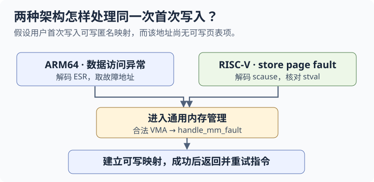

# L10 · 同一段代码，两种缺页入口

约 90 分钟。先在 RK3576 的 Linux 用户态运行，再在 K230 的 Linux 端按其工具链重新编译。保留第一份记录，第二块板晚些接入也能继续对照。

## 提出预测

匿名映射建立后，分别测量两次逐页写入的次缺页增量。预测哪一遍较多，写下页大小、透明大页和 libc 首次执行路径可能带来的影响。默认申请 2 MiB，先看板上可用内存。

## 编译并运行

保存为 `touch.c`。若开发板带有 C 编译器，直接执行下方命令。交叉编译时使用与目标镜像 ABI、动态加载器匹配的 SDK 编译器。

```c
#define _GNU_SOURCE
#include <stdio.h>
#include <sys/mman.h>
#include <sys/resource.h>
#include <unistd.h>

int main(void)
{
    long page = sysconf(_SC_PAGESIZE);
    size_t bytes = 2 * 1024 * 1024;
    if (page <= 0) return 1;
    volatile unsigned char *p = mmap(NULL, bytes, PROT_READ | PROT_WRITE,
                                     MAP_PRIVATE | MAP_ANONYMOUS, -1, 0);
    if (p == MAP_FAILED) { perror("mmap"); return 1; }

    struct rusage sample[3];
    if (getrusage(RUSAGE_SELF, &sample[0])) return 1;
    for (int pass = 0; pass < 2; ++pass) {
        for (size_t i = 0; i < bytes; i += (size_t)page)
            p[i] = (unsigned char)(pass + 1);
        if (getrusage(RUSAGE_SELF, &sample[pass + 1])) return 1;
    }
    printf("page=%ld first=%ld second=%ld\n", page,
           sample[1].ru_minflt - sample[0].ru_minflt,
           sample[2].ru_minflt - sample[1].ru_minflt);
    return munmap((void *)p, bytes) != 0;
}
```

```bash
cc -O2 -Wall -Wextra touch.c -o touch
uname -m
./touch
./touch
```

## 把一次输出还原成访存过程

下面是将本页完整程序在 WSL2 Ubuntu 的 x86_64 环境编译后连续运行三次得到的相同输出，可先用它核对计算。目标板待填入自己的测量行。

```text
page=4096 first=512 second=0
```

1. `page` 是基础页字节数。程序让索引每次增加 4096，因此对 2 MiB 做 `2097152 / 4096 = 512` 次写入。两遍循环写同一批虚拟地址。
2. `getrusage(RUSAGE_SELF)` 读取本进程资源计数。三个样本分别位于写入前、第一遍后和第二遍后。`ru_minflt` 统计无需从存储读入页面即可处理的次缺页。两两相减排除了采样开始前的累积量。
3. `first=512` 和首次逐页写时按需建立映射的预期一致。`second=0` 说明本次测量的第二遍没有新增次缺页。指针标为 `volatile` 让编译器保留这些写入。换一块板时记录其页大小，重新计算写入次数。

**自测：第二次执行整个 `./touch`，为什么又有几百个首次缺页？** 每次启动都创建一个新进程及新的匿名映射。只有同一进程内的两遍写入共享这份映射。当第一遍增量明显小于基础页数时，先检查是否启用了透明大页，再复跑较小的映射。用大页覆盖多个基础页会改变计数与写入次数的比例。若目标板上执行提示文件不存在但文件明明在，先在构建端用 `readelf -l ./touch` 检查动态加载器路径是否存在于目标 rootfs。遇到 `Exec format error` 则先用 `readelf -h` 核对架构与 ABI。

## 找到分叉与汇合

[](figures/trap-path.svg)

程序给出缺页计数。图中的异常寄存器和具体调用链还需从对应架构源码或跟踪记录核对。

在带版本号的两份源码中，从各自异常处理入口追到 `handle_mm_fault`。为 ARM64 注明访存异常信息的获取位置，为 RISC-V 注明 store page fault 的判别位置。运行计数给出现象，源码说明可能的路径；若要确认本次调用经过某个函数，还需在支持的内核上取得跟踪证据。[跨架构阅读表](arch-riscv.md)

## 验收与反例

交付两行板卡记录，包含 ISA、内核 SHA 或来源、页大小、两次增量和观测次数。把映射缩为一页重跑，用它检验“次缺页增量总等于写入的基础页数”这一说法。解释合法匿名页为何能在内核处理后回到原指令。
