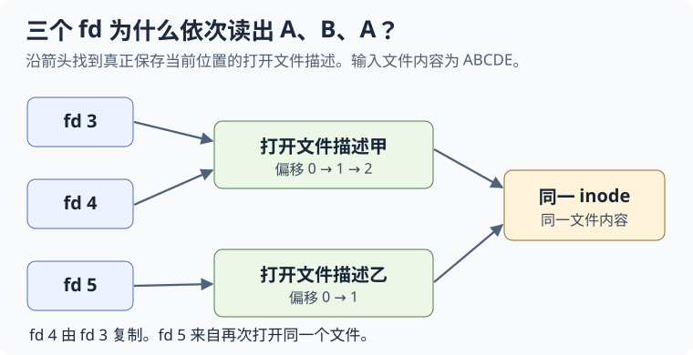

# L05 · 跟踪文件与 socket

**环境：RK3576 或 WSL2 · 约 90 分钟 · 不依赖真实外设。**

## 文件实验

在 Linux 文件系统的实验目录执行，下面只创建一个小文件：

```bash
mkdir -p ~/kernel-lab/experiments/io
cd "$(mktemp -d "$HOME/kernel-lab/experiments/io/run.XXXXXX")" || exit 1
strace -tt -T -o file.trace python3 -c '
import os
fd = os.open("sample.dat", os.O_CREAT | os.O_TRUNC | os.O_RDWR, 0o600)
os.write(fd, b"kernel-lab\n")
os.fsync(fd)
os.lseek(fd, 0, os.SEEK_SET)
print(os.read(fd, 64))
os.close(fd)
'
```

找到目标文件的 fd，关联 write、fsync、lseek、read、close。记录返回值，解释它们分别证明了什么。再次运行读取不构成严格的存储性能测试，可能命中缓存。

先用 `grep -n 'sample.dat' file.trace` 找到 `openat` 返回的描述符，再读这行之后针对同一 fd 的记录。在这里 `write` 预期返回 11（包含换行），`fsync` 成功返回 0；`lseek` 置回偏移 0，随后读出相同的 11 字节。如果系统缺少 `strace`，先用裸 `python3` 执行相同脚本，再按照[工具清单](environment.md)补装追踪工具。

## socket 实验

用 Python 的 `socket.socketpair()` 建立一对本地 socket，读端先等待，另一个线程延迟 2 秒后发送 4 字节并关闭。使用 `strace -f -tt -T` 观察各线程的调用。再把读者改为 nonblocking + `select` 或 `poll`，对照等待位置的变化。

在当前实验目录保存为 `pair.py`。两次运行只改变等待方式。流式 socket 一次读取可能只返回部分数据，因此一直读到 EOF，再打印累计结果。

```python
import select
import socket
import sys
import threading
import time

rx, tx = socket.socketpair()
def sender():
    with tx:
        time.sleep(2)
        tx.sendall(b"ping")

t = threading.Thread(target=sender)
t.start()
polling = sys.argv[1:] == ["poll"]
if polling:
    rx.setblocking(False)
    watcher = select.poll()
    watcher.register(rx, select.POLLIN)
parts = []
with rx:
    while True:
        if polling:
            watcher.poll()
        try:
            data = rx.recv(32)
        except BlockingIOError:
            continue
        if not data:
            break
        parts.append(data)
t.join()
print(b"".join(parts))
```

```bash
strace -f -tt -T -e trace=network,poll,ppoll -o block.trace python3 pair.py
strace -f -tt -T -e trace=network,poll,ppoll -o poll.trace python3 pair.py poll
cat block.trace poll.trace
```

两轮都应得到 `b'ping'`。在第一轮定位等待较久的接收调用（Linux 上常见 `recvfrom`），第二轮找 `poll` 或 `ppoll`。等待可以被移到就绪接口，接收数据的操作依然存在。多线程 trace 中若一行标记 `unfinished`，要找同一线程的 `resumed` 行拼起来。若遇到空读，先确认发送端是否已经关闭，别把 EOF 当作“稍后重试”。

一次 WSL2 实测，阻塞版的 `recvfrom` 用了 2.000119 秒并返回 4；轮询版的 `poll` 用了 2.000049 秒并返回 1，表示一个 fd 就绪。两次最终都打印 `b'ping'`，可以用这组记录核对“1 个 fd 就绪”和“收到 4 个字节”的单位。

这是本地 socket 实验，不经过完整的以太网硬件路径。下一步如想研究 TCP，单独在 loopback 上搭建服务端与客户端，并明确区别。

## 回到对象关系

[](figures/shared-offset.svg)

图中 ABCDE 是演算用的文件。把字母换成本实验的内容，沿相同箭头就能预测交替读取的结果。

画 fd 表、file 对象与 file_operations，解释普通文件、socket、设备节点分别连接到什么实现。通过 `dup` 验证同一打开文件描述的偏移共享：原 fd 读一字节，再用副本读，预测第二次读的位置。

```python
import os
a = os.open("sample.dat", os.O_RDONLY)
b = os.dup(a)
print(os.read(a, 1), os.read(b, 1))
os.close(b)
os.close(a)
```

两次读取应分别取到 `b'k'` 和 `b'e'`。再用第二次 `os.open` 代替 `os.dup`，预测并验证两次都会从文件开头读。

## 验收

1. 普通文件读写同一个 fd，为什么回读前要 `lseek`？**参考解释**：前面的写操作已经推进打开文件描述的偏移，到文件末尾后读取会看到 EOF。`fsync` 不会重置这个位置。
2. `poll` 报有事件后，`recv` 是否一定拿到 4 字节？**参考解释**：数据、关闭等状态都可能产生就绪事件。流式端点没有固定消息边界，仍要根据实际返回值累计数据或结束。

提交一段标注过的 trace 与两张分层图。能说明系统调用耗时、CPU 时间、设备完成和持久化之间的区别；能解释 `poll` 可读后为什么还应处理短读、EOF、错误或竞争变化。

参考：[open(2)](https://man7.org/linux/man-pages/man2/open.2.html)、[fsync(2)](https://man7.org/linux/man-pages/man2/fsync.2.html)、[poll(2)](https://man7.org/linux/man-pages/man2/poll.2.html)。
