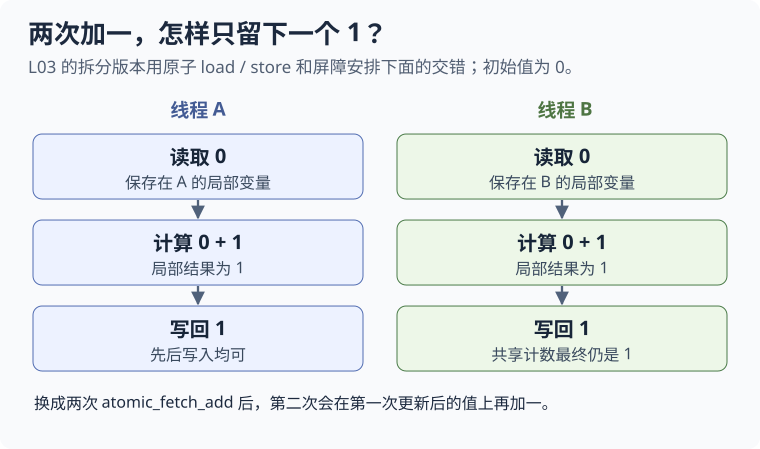

# L03 · 竞争条件与执行上下文

**环境：RK3576 或 WSL2，内核调试扩展可用 QEMU · 约 90 分钟。**

## 定义不变量

两个线程各执行 N 次加一，结束后应为 2N。先解释一次加一至少涉及读取、计算、写回，为什么两个线程可能覆盖彼此结果。

## 编写三个版本

[](figures/lost-update.svg)

左右两列都读到 0 后，各自在局部算出 1。调换最后两次写的顺序，最终值仍是 1。

在有 C11 编译器和 POSIX 线程的 Linux 上新建 `counter.c`。下面先用两个线程各加一次，刻意把两次读取放在两次写入之前。A 的每一次读写都合法，因此能把丢失更新和 C 语言的数据竞争分开解释。

| 版本 | 实现要点 | 需要解释 |
| --- | --- | --- |
| A | 分别执行原子 load 和 store，中间等待两位读者都到达 | 单次读写安全，组合后的加一仍可丢失 |
| B | `pthread_mutex_lock/unlock` 保护更新 | 临界区与不变量是什么 |
| C | C11 `_Atomic` 与 `atomic_fetch_add` | 原子更新与多个字段一致性的差别 |

```c
#define _XOPEN_SOURCE 700
#include <pthread.h>
#include <stdatomic.h>
#include <stdio.h>
#include <stdlib.h>
#include <string.h>

static pthread_barrier_t both_read;
static pthread_mutex_t mutex = PTHREAD_MUTEX_INITIALIZER;
static atomic_int split, combined;
static int protected;

static void check(int rc) {
    if (rc) { fprintf(stderr, "%s\n", strerror(rc)); exit(1); }
}
static void *increment(void *unused) {
    (void)unused;
    int old = atomic_load(&split);
    int rc = pthread_barrier_wait(&both_read);
    if (rc != PTHREAD_BARRIER_SERIAL_THREAD) check(rc);
    atomic_store(&split, old + 1);
    check(pthread_mutex_lock(&mutex));
    protected++;
    check(pthread_mutex_unlock(&mutex));
    atomic_fetch_add(&combined, 1);
    return NULL;
}
int main(void) {
    pthread_t first, second;
    check(pthread_barrier_init(&both_read, NULL, 2));
    check(pthread_create(&first, NULL, increment, NULL));
    check(pthread_create(&second, NULL, increment, NULL));
    check(pthread_join(first, NULL));
    check(pthread_join(second, NULL));
    printf("split=%d mutex=%d fetch_add=%d\n",
           atomic_load(&split), protected, atomic_load(&combined));
    check(pthread_barrier_destroy(&both_read));
    check(pthread_mutex_destroy(&mutex));
}
```

```bash
cc -std=c11 -Wall -Wextra -O2 -pthread counter.c -o counter
./counter
```

读结果前画出 A 的四步：两人都读到 0，分别算出 1，先后写回同一个 1。预期 `split=1 mutex=2 fetch_add=2`。即使在单 CPU 上，线程也可以先后到达屏障。B 的锁覆盖读取到写回的全过程，C 把整个加一合为一次原子读改写。如果改成两个线程对普通共享整数同时执行 `counter++`，C 语言将其定义为数据竞争，程序行为未定义；不要用那种写法的偶然输出估算丢失比例。

不要把 `volatile` 当成第四种正确修复。它不提供线程间互斥或原子读改写。

WSL2 上以 `-O2` 实测输出为 `split=1 mutex=2 fetch_add=2`。这里 A 的结果可以由屏障的位置推导出来。把屏障移到两次读取之前再试，A 的输出可能改变；仍应从允许的线程执行顺序解释，而不能从一次碰巧正确的结果断定程序满足不变量。

## 增加一个业务条件

把计数改成“队列长度 + 总字节数”两个字段，要求同时满足一致性。单独把两个整数变成原子变量，是否就能保证读者看到配对状态？说明为什么可能还需要统一锁、快照协议或其他设计。

再增加线程退出和对象释放：谁保证工作线程不再访问计数器？`pthread_join` 在生命周期中起什么作用？

## 迁移到内核时重新判断

假设对象被进程、IRQ 和 workqueue 访问，先列出每条路径的上下文，再选择保护方案。用户态 mutex 实验不意味着内核 IRQ 中也能使用 mutex。PREEMPT_RT 与普通配置的锁规则要分别对照。

查找一个目标驱动中真实的 `spin_lock*`、`mutex_lock`、`refcount_*` 调用，写出共享对象与保护范围。不要为了练习在板上随意替换锁类型。

## 验收

1. 屏障也会等待，为何 A 仍然丢一次更新？**参考解释**：屏障控制两个线程进入下一阶段的时间，没有约束这两个旧值如何用于回写。为了保持加一不变量，要保护完整操作。
2. 两个字段都在同一把锁里更新，读者先后无锁读取是否安全？**参考解释**：读者也须遵守兼容的同步协议。例如在同一把锁内读取两个字段形成快照，再解锁使用。普通字段与写者并发无锁访问还会引入 C 数据竞争。
3. 程序长时间不打印，先检查哪里？本例要求两个线程都通过 `pthread_create` 并各到达一次同一屏障；若把参与数误写为 3，主线程又只在 join，便没有第三位参与者。

提交三种版本、编译参数、重复运行结果和不变量分析。能回答：为什么有锁仍可能释放过早；为什么原子变量不自动保护多字段状态；为什么关闭本地中断不能解决所有跨核并发。

可选工具：线程 sanitizer 用于用户程序，lockdep/KCSAN 用于可控内核，均取决于编译器和配置。依据：[锁文档](https://docs.kernel.org/locking/index.html)、[原子类型文档](https://docs.kernel.org/core-api/wrappers/atomic_t.html)。
