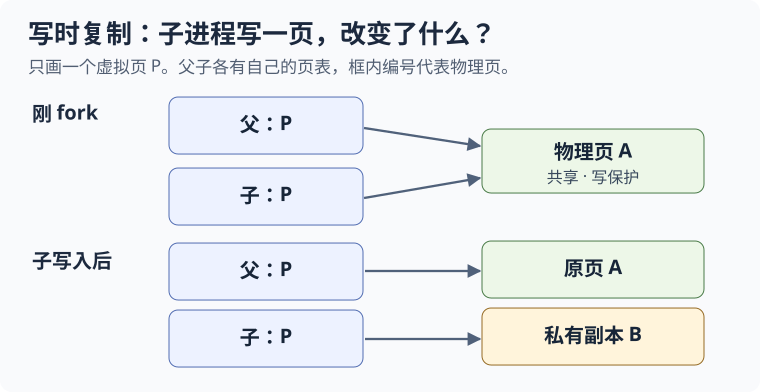

# L04 · 按需分配与写时复制

**环境：RK3576 或 WSL2 · 约 120 分钟 · 使用 32 MiB，避免给系统制造内存压力。**

## 实验设计

用 `mmap(MAP_PRIVATE | MAP_ANONYMOUS)` 申请 32 MiB，按 `sysconf(_SC_PAGESIZE)` 返回的页大小逐页访问。程序先打印父 PID 和映射起点，`fork` 后再打印子 PID。每次看到阶段名和 `[Enter]`，就用另一终端取样，记下结果再按回车。

1. 映射成功但不访问；
2. 每页读取一个字节，将结果汇总到最终打印的校验值中，避免被优化掉；
3. 每页写一个字节；
4. `fork`，父子都暂停，子进程尚未修改；
5. 只允许子进程改写一半页面，父进程保持不写，再取样；
6. 子进程退出，父进程 `waitpid`，最终 `munmap`。

先运行下面的参考实现，再尝试自己写同等的阶段控制。把代码保存为 `cow.c`。父进程负责终端交互，一根管道发命令，另一根收回执。子进程改写完毕后仍然存活，另一个终端此时可以同时观察两份映射。

```c
/* 在头文件之前启用 glibc 的 GNU 扩展声明，后面会用到匿名映射。 */
#define _GNU_SOURCE
#include <errno.h>
#include <stdio.h>
#include <stdlib.h>
#include <sys/mman.h>  /* mmap、munmap 和映射标志 */
#include <sys/wait.h>  /* waitpid 和退出状态宏 */
#include <unistd.h>  /* 管道、进程和页大小查询接口 */

/* 失败时用 perror 把操作名和当前 errno 一起打印出来，便于分清是哪一步失败。 */
static void fail(const char *name) { perror(name); exit(1); }

/* 父进程打印检查点后等一次回车。此时去另一终端读 /proc/<pid>/smaps。
 * 若标准输入已结束，退出实验，避免把后续阶段当成已经采样。 */
static void checkpoint(const char *stage) {
    printf("%s  [Enter]\n", stage);
    if (getchar() == EOF) exit(1);
}

/* 同步只需要传递一个字节。接收端读到它，就知道伙伴已经执行到这里。 */
static void send_mark(int fd) {
    if (write(fd, "x", 1) != 1) fail("write");
}

/* 当管道空且仍有写端时，read 在这里睡眠。 */
static void wait_mark(int fd) {
    char mark;
    ssize_t n = read(fd, &mark, 1);
    /* 负数表示调用出错；空管道上返回 0 表示所有写端已关闭。
     * 实验要求收到标记，两种情况都应结束。这份示例遇到 EINTR 也会报错。 */
    if (n < 0) fail("read");
    if (n == 0) { fputs("partner closed pipe\n", stderr); exit(1); }
}

int main(void) {
    setbuf(stdout, NULL);  /* 阶段提示立即可见，便于在另一终端取样。 */
    size_t len = 32UL * 1024 * 1024;  /* 32 MiB 使脏页的变化容易从进程背景开销中看出来。 */
    long page = sysconf(_SC_PAGESIZE);  /* 按本机页大小迈步，同一源码也能在其他页大小的内核上使用。 */
    if (page <= 0) fail("sysconf");

    /* NULL 让内核选地址。PROT_READ 和 PROT_WRITE 允许后续两轮访问。
     * MAP_PRIVATE 使 fork 后各自的写入保持私有。MAP_ANONYMOUS 提供初始为零的内容。
     * 匿名映射使用 fd = -1、offset = 0。volatile 让编译器保留下面的逐页访问。 */
    volatile unsigned char *p = mmap(NULL, len, PROT_READ | PROT_WRITE,
                                     MAP_PRIVATE | MAP_ANONYMOUS, -1, 0);
    if (p == MAP_FAILED) fail("mmap");  /* 后续访问 p 前先检查失败标记。 */

    /* 记下起始地址。到 smaps 里找覆盖该地址的区间，可以把映射本身和整个进程的 RSS 分开看。 */
    printf("parent=%ld start=%p page=%ld\n", (long)getpid(), (void *)p, page);
    /* 检查点 1 · 刚映射。maps 中能找到这段虚拟地址，但仅凭映射长度还不能判断有多少页驻留。 */
    checkpoint("1 mapped");

    unsigned sum = 0;
    /* 每个基础页只读首字节，累计和应为零。Linux 在一些配置下会让多个地址读同一零页。 */
    for (size_t i = 0; i < len; i += page) sum += p[i];
    printf("sum=%u\n", sum);
    /* 检查点 2 · 首次读。对照刚才的 RSS 和缺页计数；读过 32 MiB 地址范围并不要求新增 32 MiB 私有页。 */
    checkpoint("2 first read");

    /* 对同一批地址写 1。现在内核必须为写过的内容提供私有存储，之后用这些值做父子对照。 */
    for (size_t i = 0; i < len; i += page) p[i] = 1;
    /* 检查点 3 · 首次写。记录该区间的 Rss 和 Private_Dirty，并与阶段 2 的读数作差。 */
    checkpoint("3 first write");

    /* cmd 用于父 → 子放行，ack 用于子 → 父回执。每对 fd 的 [0] 用来读，[1] 用来写。 */
    int cmd[2], ack[2];
    if (pipe(cmd) || pipe(ack)) fail("pipe");

    /* 子进程继承映射与管道 fd。此时父子各有地址空间，已写过的数据页可以共享。
     * 内核对共享的私有映射施加写保护，之后的写入才有机会触发写保护缺页。 */
    pid_t child = fork();
    if (child == -1) fail("fork");
    /* fork 在子进程返回 0，在父进程返回子 PID。以下分支仅由子进程执行。 */
    if (child == 0) {
        close(cmd[1]); close(ack[0]);  /* 子只读 cmd、只写 ack。关闭多余引用，才能正确观察最后一个写端关闭。 */
        wait_mark(cmd[0]);  /* 等父进程在阶段 4 完成采样。 */

        /* 子只改前半区，后半区留作对照。以一个仍与父进程共享的普通页为例：
         * 子写入时触发写保护缺页。内核准备包含原内容的私有副本，更新子的页表，
         * 然后重试写指令。子在副本上写 2，父的映射仍指向原来的 1。
         * 透明大页会影响实际缺页粒度，不能据循环次数推定复制了多少次。 */
        for (size_t i = 0; i < len / 2; i += page) p[i] = 2;
        printf("child byte=%u\n", (unsigned)p[0]);  /* 子读回 2。 */
        send_mark(ack[1]);  /* 先报告写完，父进程才开始核对自己的值。 */
        wait_mark(cmd[0]);  /* 保持子进程及其映射存活，直到阶段 5 采样结束。 */
        _exit(0);  /* 结束子进程，不再执行父进程路径，也不运行继承的 stdio 退出清理。 */
    }

    /* 从这里开始只有父进程执行。父写 cmd、读 ack，端点方向与子进程相反。 */
    close(cmd[0]); close(ack[1]);
    printf("child=%ld\n", (long)child);
    /* 检查点 4 · fork 已完成，子还没写。分别看两个 PID 的 Shared_Dirty 和 Pss。
     * 同一物理页可以计入两个进程各自的 RSS。 */
    checkpoint("4 after fork");

    /* 先发送许可，再等子进程回执。这使下一行读到的 1 真正对应「子已经改过」这一时刻。 */
    send_mark(cmd[1]); wait_mark(ack[0]);
    printf("parent byte=%u\n", (unsigned)p[0]);  /* 父仍读到 1，与刚才子进程的 2 配对。 */
    /* 检查点 5 · 子已改写前半区。观察 Private_Dirty 增加、Shared_Dirty 减少。
     * 一个已驻留的共享页被一个私有页替代时，该进程 RSS 可以基本不变。 */
    checkpoint("5 child wrote half");

    send_mark(cmd[1]);  /* 父已采样完毕，允许子进程退出。 */
    int status;
    /* 等待指定子进程并回收它；随后先判断是否正常退出，再检查退出码。 */
    if (waitpid(child, &status, 0) < 0) fail("waitpid");
    if (!WIFEXITED(status) || WEXITSTATUS(status)) return 1;
    /* 解除父进程对这段地址的映射。页能否回收取决于是否还有其他引用。 */
    if (munmap((void *)p, len)) fail("munmap");
    return 0;
}
```

```bash
# 启用编译警告。即使用 -O2 优化，volatile 访问仍保留。
cc -Wall -Wextra -O2 cow.c -o cow
# 在前台运行，保存父 PID 和起始地址；每次采样完成后再按回车。
./cow
```

只在第一个终端按回车。到 `1 mapped` 后，在第二个终端设置 `pid=实际父进程号`（用数字替换）。到第 4 阶段再记录子 PID。子进程不需要第二个键盘输入。发生权限错误时，先确认取样与目标进程属于同一用户，若仍受限制，可以先记录程序打印的数据。

## 观测命令

将 PID 替换为实际进程号，分别记录父子进程。程序暂停时运行：

```bash
# 先用 maps 确认目标地址落在哪段映射。
cat "/proc/$pid/maps"
# rollup 是整个进程的总量；Rss 统计驻留，Pss 按比例分摊共享页，Dirty 字段区分共享与私有。
grep -E '^(Rss|Pss|Private_Dirty|Shared_Dirty):' "/proc/$pid/smaps_rollup"
# 用同一 PID 记录虚拟大小、驻留量、次缺页和主缺页计数；父子同时存活时分别取样。
ps -p "$pid" -o pid,vsz,rss,min_flt,maj_flt,comm
```

如果内核不提供 `smaps_rollup`，使用 `smaps` 并定位目标匿名区域。进程有其他分配，整体统计会包含噪声；更严谨时解析目标映射，记录页大小、THP 和相关配置。

## 如何解释结果

[](figures/cow-pages.svg)

看子进程的箭头在写入前后指向哪里。对照程序中父进程仍读到 1、子进程读到 2 的结果。

映射后的虚拟地址范围可能先增长，而驻留和私有脏页不会立即按同等大小增长；匿名读可使用共享零页等实现，不能把一次读直接当成分配独占页。逐页写与 fork 后的子进程写入，会改变驻留、共享和私有情况。

PSS 对共享页做比例分摊，RSS 可能在多个进程中重复统计共享驻留页。父子 RSS 相加不能直接表示实际物理消耗。

下面是在 x86_64 WSL2 中运行本页程序的一次实测，单位均为 kB，取自整个进程的 `smaps_rollup`。先只读父进程的三列，找出“分配并写脏”和“既有页改记为共享”的转折点，再对照最后一行子进程的数据。

| 采样时刻 | 父 RSS | 父 Shared_Dirty | 父 Private_Dirty | 子 Private_Dirty |
| --- | ---: | ---: | ---: | ---: |
| 刚映射 | 1612 | 0 | 112 | — |
| 逐页读过 | 1612 | 0 | 112 | — |
| 逐页写过 | 34380 | 0 | 32880 | — |
| fork 后、子未写 | 34508 | 32840 | 40 | 32 |
| 子写半区后 | 34508 | 16456 | 16424 | 16420 |

最后父进程保持不写，私有脏页仍然增加。子进程取得部分页的另一个副本后，对应旧页只剩父进程使用，它们在父进程的统计分类也变了。父进程首字节实测仍为 1，子进程已读到 2。

## 避免误判

fork 前的 stdio 缓冲可能导致输出重复；用 `fflush` 或无缓冲输出。父子若都持续写，会破坏只改变一个变量的设计。内存统计还受分配器、THP、系统负载与内核实现影响，不要求得到固定整数。

## 源码回看与验收

1. 为什么程序的 `sum` 是 0，逐页写后才明显增加私有脏页？**参考解释**：匿名映射承诺初始读取为零；创建 VMA 只描述可访问范围。不同系统可以在首次读时映射零页，首次写时再准备可写的私有页。结合 RSS 和故障计数判断本机情况。
2. 子进程打印 2 而父进程仍打印 1，是否说明内核在 `fork` 时已经复制了 32 MiB？**参考解释**：这个输出只证明写入互相隔离。第 4、5 阶段的共享脏页、私有脏页及 PSS 变化，才能支持“先共享，写时分离”的解释。大页会影响每次故障覆盖的范围。

追 `mm/memory.c` 中匿名页与写保护故障相关路径，解释 VMA、页表权限和物理页关系。提交各阶段快照及一张共享→写入后分离的示意图。

能回答：同一个数值的地址为什么可对应不同页；page fault 为什么不一定异常退出；为什么不能简单用“fork 后 RSS 翻倍”判定 COW 失效。

参考：[mmap(2)](https://man7.org/linux/man-pages/man2/mmap.2.html)、[smaps](https://man7.org/linux/man-pages/man5/proc_pid_smaps.5.html)。
