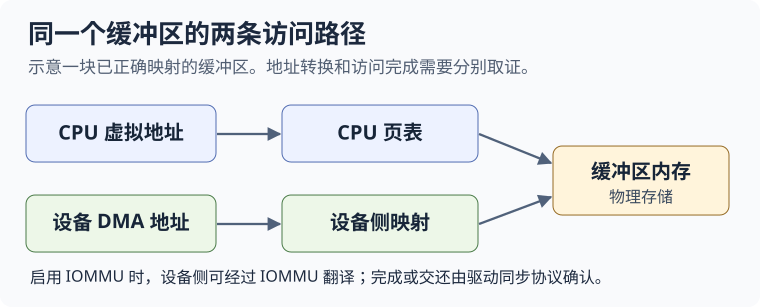

# L09 · 跟踪一帧媒体任务

**环境：已能运行媒体样例的 RK3576 BSP · 分多次完成 · 前置：任务、并发、内存、IRQ、DMA。**

## 先获得成功基线

使用板厂当前 BSP 配套的 MPP 用户库、驱动与测试程序。输入文件由你合法准备，记录格式、分辨率、帧数、校验值和完整命令。先证明能正常编/解码，再研究内部路径。

[Rockchip MPP 仓库](https://github.com/rockchip-linux/mpp)可作为用户态实现入口。实际板卡可能使用特定提交或厂商修改，不能只拿 master 对照二进制行为。

下面以一帧 H.264 解码作为起点。如果 WSL 的 FFmpeg 提供 libx264，可在新的空目录生成自己的测试输入，降低多帧重排和外部素材带来的干扰。把 `one.h264` 复制到板上的实验目录，用同一个 SHA-256 确认两端输入相同。也可以使用板厂提供并已验证的小码流，按它的实际编码格式选参数。

```bash
ffmpeg -hide_banner -f lavfi -i testsrc2=size=320x240:rate=1 \
  -frames:v 1 -c:v libx264 -pix_fmt yuv420p -f h264 one.h264
sha256sum one.h264
```

在板端运行 `command -v mpi_dec_test` 并查阅该测试程序的帮助（上游版本可不带参数运行）。当帮助明确列出 `-i` 为码流、`-t 7` 为 AVC/H.264、`-n 1` 为至多一帧时，使用下面的 Bash 示例。先查看 `baseline.log` 确认解码器成功输出一帧，只有初始化、格式变化或 EOS 提示都不足以证明输出了一帧。各 BSP 的日志文字和设备名会变化。[上游参数实现](https://github.com/rockchip-linux/mpp/blob/develop/utils/mpi_dec_utils.c) · [编码类型枚举](https://github.com/rockchip-linux/mpp/blob/develop/inc/rk_type.h)

```bash
decode=(mpi_dec_test -i one.h264 -t 7 -n 1)
"${decode[@]}" >baseline.log 2>&1
cat baseline.log
```

## 第一步：从用户边界找入口

用 `strace -f -tt -T` 记录打开的设备节点、ioctl、poll/read/write 等。某些程序可能通过其他库或服务间接提交；以实际 trace 为准。不要预先认定所有 BSP 都使用同一 `/dev` 路径。

将一次 API 操作关联到 fd 与 ioctl 编号，回到匹配版本的头文件解释参数结构。参数可能包含缓冲区句柄而非 CPU 地址。

```bash
strace -f -yy -tt -T -e trace=openat,ioctl,poll,ppoll,read,write \
  -o one.trace "${decode[@]}" >traced.log 2>&1
grep -E '/dev/|ioctl\(' one.trace | head -n 40
```

同一终端复用刚定义的 `decode` 数组。`-f` 跟踪子线程，`-yy` 尽可能把 fd 与其对象关联。旧版 strace 不支持 `-yy` 时去掉这个选项，从打开设备返回的 fd 顺查到后续 ioctl。若只有 `ENOENT` 或 `EACCES`，先查镜像中的设备与访问权限，保存错误行；在正常样例成立前不要给 IRQ 或耗时作归因。

## 第二步：在内核中找对象

找到实际绑定的驱动，沿 ioctl/提交入口识别 session、task、队列、buffer 映射和等待对象。这里的媒体 task 是驱动业务对象，不能自动当成调度器的 `task_struct`。

画用户线程、驱动工作线程/队列、硬件设备、IRQ 处理与完成通知。列出哪些动作在当前上下文执行，哪些在稍后执行。

## 第三步：连接缓冲区与完成

[](figures/dma-views.svg)

在图上标出谁正在写帧。再从驱动查完成事件，确定另一个使用者何时可以读或复用这块内存。

沿[L07](lab-dma.md)确认导入/分配、DMA-BUF attach/map、设备地址、提交、完成、同步和回收。格式、stride、对齐、压缩布局等都可能影响数据解释，不能仅凭“同一 buffer fd”推导所有内容布局。

查可用 trace 事件，优先使用已有调度/IRQ/驱动事件。驱动没有现成 tracepoint 时，先通过源码和低开销日志建立边界，是否加入最小 tracepoint 作为后续独立变更评估。保留无插桩基线。

## 第四步：建立时间线

| 事件 | 证据 | 需排除的歧义 |
| --- | --- | --- |
| 用户提交 | 用户日志/系统调用 | 一次调用可能提交多项工作 |
| 驱动入队与启动 | trace/源码对应日志 | 入队不等于硬件开始 |
| 硬件完成 | 状态与 IRQ/驱动完成事件 | IRQ 数量不一定等于帧数 |
| 唤醒与获得 CPU | sched_wakeup / sched_switch 等可用事件 | 唤醒到执行存在排队时间 |
| 用户返回与复用 | 用户日志/同步协议 | 返回与缓存可见性要核对 |

把不同日志的时钟统一或明确偏差，记录丢事件和开销。没有可观测事件的区间标为空白，不虚构精确耗时。

## 第五步：提出可区分的假设

同样是返回慢，可能来自任务排队、CPU 调度、硬件执行、同步等待或输入供给。一次只改变一个因素，例如输入规模、并发数量、CPU 亲和性；记录负载和温度条件。不通过禁用保护机制获取“更好数据”。

## 最终验收

1. 同一帧的日志里有多次 ioctl，哪一次才算“提交”？**参考解释**：查询能力、申请内存、配置格式和提交任务都可能走 ioctl。要把请求号和参数与匹配版本的用户库、内核分发分支相连，再用任务标识或时间顺序关联该帧。
2. 观察到一次 IRQ、一次用户线程唤醒，这两个点之间就是硬件解码时间吗？**参考解释**：IRQ 可以出现在硬件已经完成之后，唤醒还可能由其他事件触发。先找到启动硬件、完成确认、等待者和调度上 CPU 的证据，缺少的阶段在时间线上留空。

按[综合项目标准](capstone.md)交付版本、输入、复现、对象图、时间线与至少两组反例。明确哪些结论来自观测，哪些来自源码推断，哪些仍需要芯片手册或硬件工具确认。

这份实验验证框架尚未在你的具体板型/BSP 上执行；设备节点、函数名、可用 trace 和测试命令应由你的板卡基线确定。
