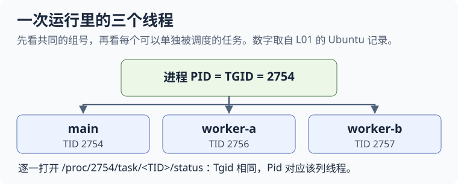

# L01 · 亲眼观察 PID / TID

**环境：RK3576 或 WSL2 · 约 60 分钟 · 前置：会编译 C。** 本实验不依赖 RK3576 特性。

## 运行前先预测

主线程执行两次 `pthread_create` 后，三个线程分别打印 `getpid()` 和 `gettid()`。先画三行两列的空表，预测哪一列会出现三个相同的数，哪一行的两个数会相等。再想想，传给 `pthread_join` 的标识应该填在哪一列。

## 准备程序

在自己的实验目录新建 `pid_threads.c`，保存下面的完整观察程序。它会保留约 30 秒，便于另一个终端查看。

```c
#define _GNU_SOURCE
#include <stdio.h>
#include <stdlib.h>
#include <string.h>
#include <unistd.h>
#include <pthread.h>

static void *worker(void *arg)
{
    const char *name = arg;
    printf("%s: pid=%ld tid=%ld\n", name,
           (long)getpid(), (long)gettid());
    sleep(30);
    return NULL;
}

int main(void)
{
    pthread_t a, b;
    setbuf(stdout, NULL);
    printf("main: pid=%ld tid=%ld\n",
           (long)getpid(), (long)gettid());
    int rc = pthread_create(&a, NULL, worker, "worker-a");
    if (rc != 0) { fprintf(stderr, "%s\n", strerror(rc)); return 1; }
    rc = pthread_create(&b, NULL, worker, "worker-b");
    if (rc != 0) {
        fprintf(stderr, "%s\n", strerror(rc));
        pthread_join(a, NULL);
        return 1;
    }
    pthread_join(a, NULL);
    pthread_join(b, NULL);
    return 0;
}
```

```bash
# 板上或 WSL 本机编译时执行；已有对应架构的可执行文件时跳过这行
cc -Wall -Wextra -g -O0 -pthread pid_threads.c -o pid_threads
./pid_threads &
pid=$!
# 等程序打印三个线程标识，再采样；下面的短暂停顿方便手工观察。
sleep 1
ps -L -p "$pid" -o pid,tid,stat,comm
ls "/proc/$pid/task"
grep -E '^(Name|State|Tgid|Pid|Threads):' "/proc/$pid/status"

# 在线程退出前，分别读取组长和两个 worker 的记录
for status in "/proc/$pid/task/"*/status; do
    printf '\n%s\n' "$status"
    grep -E '^(Tgid|Pid|Threads):' "$status"
done
wait "$pid"
```

`&` 让程序在后台运行，紧接着的 `$!` 取得这次启动的后台进程号。进程结束后，相应的 `/proc` 目录就会消失。把整段命令放在同一个终端执行，或把这个 PID 记下来，在另一个终端观察。如果精简板载系统的 `ps` 缺少 `-L` 选项，仍可用上面的 `/proc` 循环读出每个线程的标识。

## 实测记录：为什么三个 PID 都是 2754？

[](figures/thread-group.svg)

先沿 worker-a 向上找进程号，再用它自己的 TID 向下找 `/proc/2754/task/2756/status`。同一个线程，两条查找路径各回答一个问题。

下表整理自一次实际的 Ubuntu 终端记录。每行左边是程序打印的值，右边是同一次运行中 `ps -L -p "$pid" -o pid,tid,stat,comm` 的结果。下次实验使用当次的 `$pid` 即可。

| 线程 | 程序 `getpid()` | 程序 `gettid()` | `ps` 的 PID | `ps` 的 TID | `ps` 的 STAT |
| --- | ---: | ---: | ---: | ---: | --- |
| main | 2754 | 2754 | 2754 | 2754 | Sl |
| worker-a | 2754 | 2756 | 2754 | 2756 | Sl |
| worker-b | 2754 | 2757 | 2754 | 2757 | Sl |

**2754 标识整个线程组，也恰好是组长的 TID。** 在本实验的 PID 命名空间中，用户态所说的进程 PID，就是 `getpid()` 返回的线程组 ID（TGID）。同一组里的每个线程都可被独立调度，各有一个 TID。因此，worker-a 可以同时说“我所处的进程是 2754”和“我这个线程是 2756”。即使进程只有主线程，它也构成一个成员数为一的线程组。[getpid(2)](https://man7.org/linux/man-pages/man2/getpid.2.html) · [gettid(2)](https://man7.org/linux/man-pages/man2/gettid.2.html)

这次 `ls /proc/2754/task` 实际列出 `2754  2756  2757`，而 `/proc/2754/status` 给出 `Tgid: 2754`、`Pid: 2754` 和 `Threads: 3`。这个路径的身份字段对应线程组组长。现在看上面循环中 **worker-a 自己的** `status`：按这次编号，路径是 `/proc/2754/task/2756/status`。应读到 `Pid: 2756`、`Tgid: 2754`。这一步用不同的两个数区分了字段含义。[proc_pid_status(5)](https://man7.org/linux/man-pages/man5/proc_pid_status.5.html) · [proc_pid_task(5)](https://man7.org/linux/man-pages/man5/proc_pid_task.5.html)

另一次在 WSL2 Ubuntu 上复跑时，worker-a 打印 `pid=3025 tid=3027`。循环读到的对应文件如下，可以用它核对上面的预测。

```text
/proc/3025/task/3027/status
Tgid:   3025
Pid:    3027
Threads:        3
```

`Sl` 中的大写 `S` 表示采样时线程处于可中断睡眠，小写 `l` 是 procps 对多线程进程的标记。worker 调用了 `sleep`，主线程则可能在 `pthread_join` 中等待。单看 `S` 无法确定具体的等待位置。组内 TID 也无需连续，这份记录不足以确定 2755 当时分配给了谁。[ps(1)](https://man7.org/linux/man-pages/man1/ps.1.html)

## 按执行顺序读懂程序

1. **先准备声明和输出。** 在 glibc 环境中，把 `_GNU_SOURCE` 放在头文件前，让支持 `gettid()` 的 `<unistd.h>` 暴露其声明。`-pthread` 让编译器按 POSIX 线程程序编译和链接。`setbuf(stdout, NULL)` 关闭标准输出缓冲，便于马上看到记录。主线程的打印写在创建 worker 之前，因此程序的第一行来自 main。
2. **把工作交给新线程。** `pthread_create(&a, NULL, worker, "worker-a")` 成功时把线程库句柄存入 `a`，按默认属性创建一个可 join 的线程，并让它从 `worker` 开始执行。最后一个参数传给 `void *arg`，所以 `const char *name = arg` 读到的是传入的字符串。`worker-a` 只是程序打印的标签，代码没有设置系统线程名，这也解释了为什么 `ps` 的三行 COMMAND 都显示 `pid_threads`。
3. **观察并等待。** 两个 worker 各自打印身份，然后 `sleep(30)`，给人留出观察窗口。两个 worker 的先后由调度决定，睡眠时间可以重叠。主线程先 `pthread_join(a, NULL)`，再等 `b`。目标尚在运行时，join 会等待；目标已经退出时，就可以直接完成回收。`NULL` 表示调用者不取线程返回值。
4. **看清错误路径。** `pthread_create` 成功返回 0，失败时直接返回错误码，所以这里用 `strerror(rc)` 解释原因。若第二次创建失败，程序只 join 已成功创建的 `a`。如果让 main 在创建后直接返回，整个进程会退出，worker 的后续输出就没有保证。[pthread_create(3)](https://man7.org/linux/man-pages/man3/pthread_create.3.html) · [pthread_join(3)](https://man7.org/linux/man-pages/man3/pthread_join.3.html)

回到开头的预测：`pthread_self()` 返回线程库使用的 `pthread_t`，和 `a`、`b` 同类型。用它调用 pthread 接口，用 `pthread_equal` 比较两个这样的句柄。要在 `ps` 或 `/proc` 中找到当前线程，应记录 `gettid()` 的结果。

## 回到源码

在 `include/linux/sched.h` 找到 `task_struct`。每个线程各有一个 task；`pid` 字段标识该 task，`tgid` 字段标识它所在的线程组。再到 `kernel/sys.c` 看 `getpid` 与 `gettid` 分别调用的 `task_tgid_vnr`、`task_pid_vnr`，理解命名空间如何影响用户看到的数值。[Linux v6.12 的 task_struct](https://github.com/torvalds/linux/blob/v6.12/include/linux/sched.h) · [系统调用实现](https://github.com/torvalds/linux/blob/v6.12/kernel/sys.c)

在 `kernel/fork.c` 搜 `CLONE_THREAD`，找新 task 加入现有线程组的分支。同时观察 `CLONE_VM` 和 `CLONE_FILES` 如何控制地址空间和文件描述符表的共享。画图时，为三个 task 分别标出 TID，再把它们连到同一线程组、同一地址空间和同一份文件描述符表。[Linux v6.12 的任务创建](https://github.com/torvalds/linux/blob/v6.12/kernel/fork.c)

## 改一个条件

把其中一个线程的休眠时间改成 5 秒，重复观察 `/proc/PID/task` 的数量变化；再用 `fork()` 创建子进程，对照 PID 和地址空间模型。不要仅凭输出顺序判断调度策略。

## 验收与提交

提交程序、编译命令、一次完整输出和一张 task/资源关系图。遮住上面的表，回答三个问题后再标记完成。

1. worker-a 打印 `pid=2754 tid=2756`。要找它自己的状态，应该打开哪个路径？预计其中的 `Tgid` 和 `Pid` 各是多少？
2. 为什么 main 那一行的两列相等？单独查看组长的 `status`，能否区分两个字段的含义？
3. 哪个标识该传给 `pthread_join`？哪个能在 `ps -L` 的 TID 列中找到？

## 核对你的三道自测

1. 路径是 `/proc/2754/task/2756/status`。`Tgid` 应为 2754，`Pid` 应为 2756；下次运行要换上那一次的实际编号。
2. main 是该线程组的组长，组长的 TID 用作本组 TGID。因此只看组长时两列相等，选一个 worker 才能让两个定义对应到不同数值。
3. `pthread_join` 接收创建线程时取得的 `pthread_t`，如变量 `a`。与 `ps -L` 的 TID 列核对时，使用该线程调用 `gettid()` 得到的值。

依据：[gettid(2)](https://man7.org/linux/man-pages/man2/gettid.2.html)、[/proc/PID/status](https://man7.org/linux/man-pages/man5/proc_pid_status.5.html)。下一实验：[L02](lab-wait.md)。
