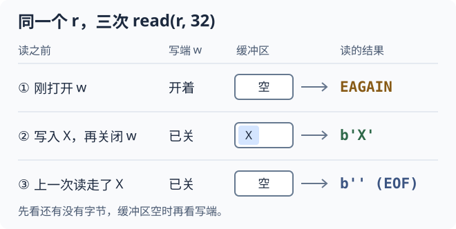

# L02 · 一个 read 为什么睡眠

**环境：RK3576 或 WSL2 · 约 90 分钟 · 前置：L01、基本管道语义。** 使用两个终端和同一个实验目录。

## 先明确实验问题

[](figures/fifo-waits.svg)

先用手遮住写者一列，沿 A 向下读。A 能打印 `opened`，说明它已经拿到了 fd；接下来若屏幕又安静了，去 trace 中找这个 fd 上的 `read`。

空管道上仍有写端打开时，阻塞 read 会等数据；所有写端都关闭且数据耗尽时，read 返回 0。非阻塞模式又会走不同分支。先预测三种情况下的结果。

### 先问能不能打开，再问有没有字节

| 对 FIFO 做什么 | 当时的条件 | Linux 上会看到什么 |
| --- | --- | --- |
| 阻塞打开读端 `O_RDONLY` | 没有写端打开 | 等到有写端打开，读者才拿到 fd |
| 阻塞打开写端 `O_WRONLY` | 没有读端打开 | 等待读端打开 |
| 非阻塞打开读端 | 即使没有写端 | 打开成功。此后读空管道时，若没有写端则返回 0；若仍有写端则报 EAGAIN |
| 非阻塞打开写端 | 没有读端打开 | 打开失败，错误为 ENXIO，尚未得到 fd |
| 以 `O_RDWR` 打开 | 没有其他进程参与 | Linux 允许打开，同一个 fd 同时持有两端。用它做阻塞读，仍可能等数据 |

打开方式作用于**端点**。即使写者进程已经启动，只要它还没打开这个 FIFO，读者仍可能等在 open。先用 `test -p lab.fifo` 确认路径类型。换成本地空普通文件，打开时无需匹配写端，从开头读就会得到 EOF。[fifo(7)](https://man7.org/linux/man-pages/man7/fifo.7.html)

## 终端 A：创建命名管道并启动读者

```bash
# 两端都在这个目录运行，确保相对路径 lab.fifo 指向同一个命名管道。
mkdir -p ~/kernel-lab/experiments/wait
cd ~/kernel-lab/experiments/wait
# 若已存在 lab.fifo，先确认它是上次实验的 FIFO；不要覆盖其他文件
test -p lab.fifo || mkfifo lab.fifo || exit 1
# -tt 记调用时刻，-T 记耗时；读者的跟踪单独存入 reader.trace。
strace -tt -T -o reader.trace python3 -c '
import os
# 第一次可能睡眠的位置：只读阻塞打开会等到一个写端也打开。
fd = os.open("lab.fifo", os.O_RDONLY)
# 能看到 PID 就说明 open 已返回。flush 让这行可以马上用于 ps 采样。
print("opened, reader PID =", os.getpid(), flush=True)
# 第二次可能睡眠的位置：写端已打开、缓冲区为空，等写入后最多取 32 字节。
data = os.read(fd, 32)
# repr 会把收到的换行显示出来，便于和 trace 中的返回长度核对。
print("read returned:", repr(data), flush=True)
os.close(fd)
'
```

此时可能先阻塞在 FIFO 的 `openat`，尚未到 read。这个细节必须在 trace 中区分。

## 终端 B：打开写端，延迟发送

```bash
# 与读者进入同一个实验目录。
cd ~/kernel-lab/experiments/wait
python3 -c '
import os, time
# 阻塞打开写端。返回时读写两端已配对，读者可以进入 read。
fd = os.open("lab.fifo", os.O_WRONLY)
print("writer opened; waiting 8 seconds", flush=True)
# 保持写端打开但不送数据，让读者的 read 出现约 8 秒的等待。
time.sleep(8)
# 五个字母加一个换行，一共送入 6 字节。
os.write(fd, b"hello\n")
# 保持写端再开两秒。读者若尝试再读，需要等最后一个写端关闭才能读到 EOF。
time.sleep(2)
os.close(fd)
'
```

在 8 秒窗口内，第三个终端运行 `ps -p PID -o pid,stat,wchan,comm`，把 PID 换成 A 刚打印的数字。`wchan` 受权限、符号和配置影响，不保证显示固定名称。若提示缺少 `strace`，见[基础工具安装](environment.md)；也可先用 `python3 -c` 直接运行同一读者，保留 Python 输出作为第一份观察。

## 应当看到什么

读者先在 open 等写端，随后打印 opened，再在 read 等待约 8 秒，最终得到 `hello\n`。查 `reader.trace` 中 FIFO 对应 fd 的 `openat` 和 `read`；Python 启动时也有很多无关 read，不能把最后一个 read 或最长一个 read 直接当目标。

`strace -T` 反映系统调用从进入到退出的观测时长，里面可能包含睡眠和调度，不是纯 CPU 执行时间。唤醒意味着具备继续执行的机会，不保证立即返回用户态。

一次 WSL2 实测中，`openat` 返回 fd 3，仅用 0.000043 秒；两个终端启动得很接近。随后 `read(3, "hello\n", 32)` 返回 6，耗时 8.000115 秒。这个 6 对应五个英文字母和一个换行。若你让 B 晚启动 5 秒，预计变长的是 `openat`，而写端打开后的延迟仍由 B 的 8 秒睡眠控制。

### 在 trace 中圈出两段等待

另一次在 WSL2 故意让写者晚约 2 秒打开，再隔 8 秒写入。下面摘录读者的两行实测记录，省去 `-yy` 附加的临时目录路径。

```text
13:48:42.830541 openat(AT_FDCWD, "lab.fifo", O_RDONLY|O_CLOEXEC) = 3 <1.952498>
13:48:44.783132 read(3, "hello\n", 32) = 6 <8.000076>
```

1. 先圈出第一行的文件名和返回值 `3`。下一行的 `read(3, ...)` 正是从刚打开的 FIFO 读。Python 启动时还会读其他文件，要沿这次打开所得的 fd 来配对。
2. 行首是 `-tt` 记录的调用时间，行尾尖括号是 `-T` 记录的调用耗时，单位为秒。第一行进入时间加 1.952498 秒，约为 13:48:44.783039；此后读者才有机会执行下一次 read。
3. 第二行请求最多 32 字节，实际得到 6 字节。8.000076 秒覆盖等写者送来数据及恢复执行等时间。A 读完便可关闭并退出；B 随后额外睡 2 秒，不延长 A 已经完成的这次 read。

正在等待时，trace 可能只显示部分调用行，返回值和完整耗时须等调用结束后查看。第一次 open 很快也正常：两端启动得越近，第一段越短。要单独拉长第二段，只改变 B 打开后的 sleep。[strace 手册](https://man7.org/linux/man-pages/man1/strace.1.html)

## 改一个条件，再预测结果

在前面的双终端实验里，先试着只删掉 B 的 `os.write`。A 的 `open` 仍能返回，因为 B 打开了写端。预测一下接下来的 `read` 会在哪一行被唤醒，再用 trace 核对。若全程无人写入，B 关闭最后一个写端时，A 会得到空字节串。

### 单进程逐行拆解：同一个读端为什么有三种结果？

这段代码合并验证两个问题：读端加 `O_NONBLOCK` 后，遇到空管道会怎样？最后一个写端关闭时，已经写入的字节去哪了？一个 Python 进程先后拿到两个独立的文件描述符，`r` 负责读，`w` 负责写。这样每次读之前，我们都知道上一步究竟做了什么。

等 A 和 B 都退出后，在刚才含有 `lab.fifo` 的实验目录运行。先预测执行 `os.close(w)` 后的**第一次**读会得到什么，再对照输出。

```bash
python3 - <<'PY'
import os
# 先取得非阻塞读端，没有写者也能成功打开。
r = os.open("lab.fifo", os.O_RDONLY | os.O_NONBLOCK)
# 现在已有读者，非阻塞写端能成功打开。
w = os.open("lab.fifo", os.O_WRONLY | os.O_NONBLOCK)
try:
    # 第一次读：缓冲区空，w 仍开着。read 报 EAGAIN，跳到 except，外层 print 不执行。
    print(os.read(r, 32))
except BlockingIOError as e:
    # 打印异常中的错误号；两个描述符仍可继续使用。
    print("writer open, no data:", e.errno)
# 写入一个字节，随后关掉唯一写端。关闭不会丢弃排队的 X。
os.write(w, b"X")
os.close(w)
# 第二次读：虽然 w 已关闭，仍读到 X。这次读取把缓冲区清空。
print("writer closed, buffered:", os.read(r, 32))
# 第三次读：缓冲区空且没有写端，得到零字节，即 b''。
print("writer closed, drained:", os.read(r, 32))
# 最后释放读端；目录中的 FIFO 名称仍在。
os.close(r)
PY
```

| 执行到哪一行 | 这一行怎样改变状态？你会看到什么？ |
| --- | --- |
| `python3 - <<'PY'` 与末行 `PY` | shell 把中间整段交给同一个 Python 解释器执行。三次读共享同一个 `r`。 |
| `import os` | 引入打开、读取、写入和关闭文件描述符的接口，以及打开标志。 |
| `r = os.open(…)` | `O_RDONLY` 选择读端，按位或运算把 `O_NONBLOCK` 加到打开标志中。即使还没有写者，打开也成功，返回的整数保存在 `r`。 |
| `w = os.open(…)` | `O_WRONLY` 选择写端。上一步的 `r` 仍开着，内核能找到读端，这次打开成功。如果交换这两行，在没有其他读者时，非阻塞打开写端会报 `ENXIO`，连 `w` 都拿不到。 |
| `try:` 和 `print(os.read(r, 32))` | Python 先求 `os.read` 的值。32 是本次最多读取的字节数。缓冲区为空，写端仍在，非阻塞读立即报 `EAGAIN`。这一行的 `print` 没有执行。 |
| `except BlockingIOError as e:` 和 `print(…, e.errno)` | Python 把这个系统调用错误转成异常，在这里捕获并打印错误号。程序继续向下执行，两个描述符都仍然有效。 |
| `os.write(w, b"X")` | 把一个字节放入 FIFO。缓冲区从空变成了含有 `X`，此时还无人读取它。 |
| `os.close(w)` | 关闭这次实验唯一的写端。内核中还有那个字节，读端 `r` 也仍然开着。 |
| `print("writer closed, buffered:", os.read(r, 32))` | 第二次读发生在写端**已经关闭**之后。还有一个可读字节，所以返回 `b'X'`；这次读取也把缓冲区读空了。 |
| `print("writer closed, drained:", os.read(r, 32))` | 第三次读时，缓冲区空，写端数也为零。系统调用成功返回长度 0，Python 表示为 `b''`，这就是此次读取的 EOF。 |
| `os.close(r)` | 释放最后一个读描述符。目录中的 FIFO 名称仍在，下次实验还能通过这个名字重新打开它。 |

在 WSL2 Ubuntu 中可以看到以下输出。第一行的 11 是这台系统上的 `EAGAIN` 错误号。

```text
writer open, no data: 11
writer closed, buffered: b'X'
writer closed, drained: b''
```

[](figures/fifo-three-reads.svg)

判断一次正长度的读，按顺序问两个问题。**缓冲区有字节吗？** 有就先读走可用字节。**如果空了，此刻还有写端开着吗？** 有写端，非阻塞读报 `EAGAIN`，阻塞读则等待。没有写端，这两种模式都能读到 EOF。若你的第三次读仍报 `EAGAIN`，检查是否有另一个终端持有写端。[pipe(7)](https://man7.org/linux/man-pages/man7/pipe.7.html)

**验证 EOF 的时间含义。** 在 `r = os.open(…)` 后面、打开 `w` 前面插入 `print("before writer:", os.read(r, 32))`。同一个读端会先读到 `b''`，稍后仍能收到 `b'X'`。命名 FIFO 可由后来的写者重新打开，所以一次 EOF 描述的是这次读取时的状态。

### 给另外四种情况各做一次对照

每组都从同一目录中已建好的 FIFO 开始，做完一组再做下一组。前面的单进程程序已经演示了非阻塞读与 EOF。下面分别观察写端等待、读写方式打开、失去读者和写满缓冲区。

**① 写端先启动，谁会等在打开这一步？** 先在终端 B 运行第一段，隔几秒后在终端 A 运行第二段。两个终端都要在同一个实验目录。

```bash
# 先在 B 启动，只跟踪 openat，观察它什么时候返回。
strace -tt -T -e trace=openat -o writer-open.trace python3 -c '
import os
# 读端尚未出现，阻塞在这里。只有打开成功后才能打印提示。
w = os.open("lab.fifo", os.O_WRONLY)
print("writer opened")
os.close(w)
'
# 从 Python 启动时的许多打开操作中筛出这条 FIFO。
grep '"lab.fifo"' writer-open.trace
```

```bash
# 隔几秒再在 A 启动这段。
python3 -c '
import os
# 与 B 等待中的写端配对，双方都能完成打开；本组无需读写字节。
r = os.open("lab.fifo", os.O_RDONLY)
print("reader opened")
os.close(r)
'
```

B 的 `os.open` 使用阻塞模式，读端尚未打开时，下一行没有机会打印。A 打开读端后，两端都能拿到 fd 并各自关闭。B 的 `grep` 选出这条 FIFO 的打开记录，行尾耗时约为两端启动的间隔。这次代码里连 `read` 都没有，仍然能观察到等待。

**② 一个 fd 同时持有两端，阻塞会移到哪一步？** 在 Linux 上运行下面一段。为让实验自行结束，安排一个线程稍后送来字节。

```bash
# -f 跟踪稍后启动的线程，-yy 给 fd 标出路径，便于配对开始和恢复的调用。
strace -f -tt -T -yy -e trace=openat,read,write -o rdwr.trace python3 - <<'PY'
import os
from threading import Timer
# Linux 允许一个 fd 同时持有读写两端，当前没有其他写者也能打开。
fd = os.open("lab.fifo", os.O_RDWR)
print("opened", flush=True)
# 安排另一个线程半秒后写一个字节。构造 Timer 后还需 start 才会开始计时。
wake = Timer(0.5, os.write, args=(fd, b"R"))
wake.start()
# fd 是阻塞模式，缓冲区空时在这里等；定时线程写入后，得到 R。
print(os.read(fd, 32))
# 等定时线程完成，再关闭共享的 fd。
wake.join()
os.close(fd)
PY
# 同时保留带 FIFO 路径的行和恢复的 read 行，后者可能没有路径。
grep -E 'lab\.fifo|<\.\.\. read resumed>' rdwr.trace
```

`O_RDWR` 让同一个 fd 持有读写两端，因此没有其他进程时也能打开。`Timer` 定义半秒后执行的写操作，`start()` 启动定时线程。主线程立即调用阻塞式 `read`，定时线程的 `write` 把它唤醒，于是打印 `b'R'`。`join()` 等定时线程退出后再关闭 fd。跟踪中 `-f` 包含新线程，`-yy` 在 fd 旁标出 FIFO 路径。若出现 `unfinished` 和 `resumed`，用同一个线程号配对，两行合起来是一次调用。[fifo(7)](https://man7.org/linux/man-pages/man7/fifo.7.html)

**③ 读端全关以后再写，写者会看到什么？** 用一个进程控制关闭顺序，每次都能走到同一条写语句。

```bash
python3 - <<'PY'
import errno, os
# 先开非阻塞读端，让下一行能取得写端。
r = os.open("lab.fifo", os.O_RDONLY | os.O_NONBLOCK)
w = os.open("lab.fifo", os.O_WRONLY)
# 关掉唯一读者，再尝试写入，保证 write 碰到的确实是无读者状态。
os.close(r)
try:
    os.write(w, b"X")
# Python 默认忽略 SIGPIPE。这里捕获写入失败并打印符号名 EPIPE。
except BrokenPipeError as e:
    print(errno.errorcode[e.errno])
os.close(w)
PY
```

先开 `r`，保证 `w` 能成功打开。`close(r)` 移走最后一个读端，随后的 `write` 触发 `SIGPIPE`。Python 默认忽略该信号，因此能捕获写操作的 `BrokenPipeError`，用 `errno.errorcode` 打印符号名 `EPIPE`。使用系统默认信号处置的写者通常会直接终止。[Python 信号文档](https://docs.python.org/3/library/signal.html)

**④ 管道究竟能放多少字节？** 保留读端但一直不读，写端使用非阻塞模式，这样满了以后程序还可以打印结果。

```bash
python3 - <<'PY'
import fcntl, os
# 保留一个读者以便写端打开，但整个实验都不从 r 取数据。
r = os.open("lab.fifo", os.O_RDONLY | os.O_NONBLOCK)
# 写端也设非阻塞，这样写不下时程序能转到异常处理并报告结果。
w = os.open("lab.fifo", os.O_WRONLY | os.O_NONBLOCK)
# 向内核查询这个 FIFO 的容量，单位为字节。
capacity = fcntl.fcntl(w, fcntl.F_GETPIPE_SZ)
total = 0
while True:
    try:
        # 一次写 1024 字节，把成功返回的字节数加进 total。
        total += os.write(w, b"x" * 1024)
    # 空间不足以容纳这个小块时得到 EAGAIN，停止循环。
    except BlockingIOError:
        break
# 并排比较本次查询容量和实写字节数，再释放两个端点。
print("capacity =", capacity, "bytes; written =", total, "bytes")
os.close(w)
os.close(r)
PY
```

`F_GETPIPE_SZ` 查询这一根管道的容量，单位是字节。`total` 每次只加上一次成功写入返回的字节数。Linux 上 1024 字节小于 `PIPE_BUF`，空间不足以容纳这整块时，非阻塞写报 `EAGAIN`，循环在异常分支结束。若只给读端加非阻塞标志，写端写满后就会停在 `os.write`，无法走到打印行。请记录自己的两个数，容量随内核配置和资源限制而变。[管道容量查询](https://man7.org/linux/man-pages/man2/F_GETPIPE_SZ.2const.html)

### 回到双终端的 trace

在 A 运行 `grep -E 'lab\.fifo|hello' reader.trace`，从打开 FIFO 返回的数字开始匹配同一个 fd，核对返回字节数是否包含换行。

| 改动 | 预测 | 核对位置 |
| --- | --- | --- |
| 先启动 B，在 B 的 Python 命令前也加 `strace -tt -T -o writer.trace` | B 的阻塞打开等待读端，随后才开始 8 秒睡眠 | B 的 openat 返回值与耗时 |
| A 读完 6 字节后，关闭前再阻塞读一次 | 此时若无更多数据，第二次读等到 B 关闭最后一个写端，再返回 0 | A 的第二条 read 和 B 的 close |
| A 先关闭最后一个读端，B 再尝试写入 | 默认信号处置下写者可能因 SIGPIPE 终止；忽略该信号时写调用报 EPIPE，Python 通常表现为 BrokenPipeError | 写者的 write 与信号记录 |

若要研究写满后的等待，先用 Linux 的 `fcntl(fd, F_GETPIPE_SZ)` 查询这个管道的容量。容量会随系统配置变化；`PIPE_BUF` 描述多写者并发时小块写入的原子性界限。单次请求了多少字节，还要结合剩余空间、读者是否消费及阻塞模式，才能解释返回结果。[pipe(7)](https://man7.org/linux/man-pages/man7/pipe.7.html)

## 源码与时间线

在 `fs/pipe.c` 中找读路径与等待条件，结合 `include/linux/wait.h` 画：条件检查、等待者登记、释放锁/调度、写入、唤醒、重新检查、复制数据。实际函数名和细节按版本查找。

## 验收

先合上记录回答，再检查解释。

1. A 连 `opened` 都没有打印，是否已经在管道里等数据？**参考解释**：程序先用阻塞模式打开 FIFO，尚未遇到写者时，等在打开这一步。终端 B 打开写端，A 才能进入读取。
2. B 写入后立刻关闭，为什么 A 仍能读到数据？**参考解释**：已写入的字节仍在管道中。读完缓冲区、写端引用也全部关闭后，接下来的一次读取才返回 0。

给出正常数据、EOF、EAGAIN 三组结果。解释为什么“没有数据”不足以判断 read 是否睡眠；为什么 syscall 时长不能直接当设备耗时；为什么唤醒后还要检查条件。参考：[pipe(7)](https://man7.org/linux/man-pages/man7/pipe.7.html)、[fifo(7)](https://man7.org/linux/man-pages/man7/fifo.7.html)。
