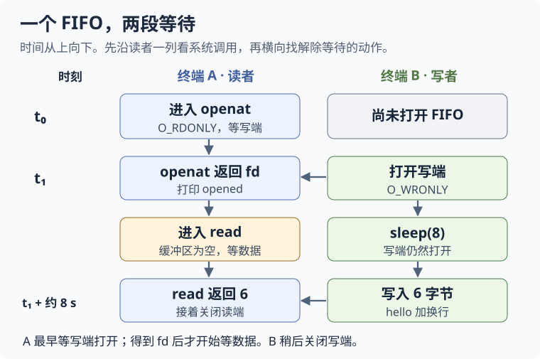

# L02 · 一个 read 为什么睡眠

**环境：RK3576 或 WSL2 · 约 90 分钟 · 前置：L01、基本管道语义。** 使用两个终端和同一个实验目录。

## 先明确实验问题

[](figures/fifo-waits.svg)

先用手遮住写者一列，沿 A 向下读。A 能打印 `opened`，说明它已经拿到了 fd；接下来若屏幕又安静了，去 trace 中找这个 fd 上的 `read`。

空管道上仍有写端打开时，阻塞 read 会等数据；所有写端都关闭且数据耗尽时，read 返回 0。非阻塞模式又会走不同分支。先预测三种情况下的结果。

### 先问能不能打开，再问有没有字节

| 对 FIFO 做什么 | 当时的条件 | Linux 上会看到什么 |
| --- | --- | --- |
| 阻塞打开读端 `O_RDONLY` | 没有写端打开 | 等到有写端打开，读者才拿到 fd |
| 阻塞打开写端 `O_WRONLY` | 没有读端打开 | 等待读端打开 |
| 非阻塞打开读端 | 即使没有写端 | 打开成功。此后读空管道时，若没有写端则返回 0；若仍有写端则报 EAGAIN |
| 非阻塞打开写端 | 没有读端打开 | 打开失败，错误为 ENXIO，尚未得到 fd |
| 以 `O_RDWR` 打开 | 没有其他进程参与 | Linux 允许打开，同一个 fd 同时持有两端。用它做阻塞读，仍可能等数据 |

打开方式作用于**端点**。即使写者进程已经启动，只要它还没打开这个 FIFO，读者仍可能等在 open。先用 `test -p lab.fifo` 确认路径类型。换成本地空普通文件，打开时无需匹配写端，从开头读就会得到 EOF。[fifo(7)](https://man7.org/linux/man-pages/man7/fifo.7.html)

## 终端 A：创建命名管道并启动读者

```bash
mkdir -p ~/kernel-lab/experiments/wait
cd ~/kernel-lab/experiments/wait
# 若已存在 lab.fifo，先确认它是上次实验的 FIFO；不要覆盖其他文件
test -p lab.fifo || mkfifo lab.fifo || exit 1
strace -tt -T -o reader.trace python3 -c '
import os
fd = os.open("lab.fifo", os.O_RDONLY)
print("opened, reader PID =", os.getpid(), flush=True)
data = os.read(fd, 32)
print("read returned:", repr(data), flush=True)
os.close(fd)
'
```

此时可能先阻塞在 FIFO 的 `openat`，尚未到 read。这个细节必须在 trace 中区分。

## 终端 B：打开写端，延迟发送

```bash
cd ~/kernel-lab/experiments/wait
python3 -c '
import os, time
fd = os.open("lab.fifo", os.O_WRONLY)
print("writer opened; waiting 8 seconds", flush=True)
time.sleep(8)
os.write(fd, b"hello\n")
time.sleep(2)
os.close(fd)
'
```

在 8 秒窗口内，第三个终端运行 `ps -p PID -o pid,stat,wchan,comm`，把 PID 换成 A 刚打印的数字。`wchan` 受权限、符号和配置影响，不保证显示固定名称。若提示缺少 `strace`，见[基础工具安装](environment.md)；也可先用 `python3 -c` 直接运行同一读者，保留 Python 输出作为第一份观察。

## 应当看到什么

读者先在 open 等写端，随后打印 opened，再在 read 等待约 8 秒，最终得到 `hello\n`。查 `reader.trace` 中 FIFO 对应 fd 的 `openat` 和 `read`；Python 启动时也有很多无关 read，不能把最后一个 read 或最长一个 read 直接当目标。

`strace -T` 反映系统调用从进入到退出的观测时长，里面可能包含睡眠和调度，不是纯 CPU 执行时间。唤醒意味着具备继续执行的机会，不保证立即返回用户态。

一次 WSL2 实测中，`openat` 返回 fd 3，仅用 0.000043 秒；两个终端启动得很接近。随后 `read(3, "hello\n", 32)` 返回 6，耗时 8.000115 秒。这个 6 对应五个英文字母和一个换行。若你让 B 晚启动 5 秒，预计变长的是 `openat`，而写端打开后的延迟仍由 B 的 8 秒睡眠控制。

### 在 trace 中圈出两段等待

另一次在 WSL2 故意让写者晚约 2 秒打开，再隔 8 秒写入。下面摘录读者的两行实测记录，省去 `-yy` 附加的临时目录路径。

```text
13:48:42.830541 openat(AT_FDCWD, "lab.fifo", O_RDONLY|O_CLOEXEC) = 3 <1.952498>
13:48:44.783132 read(3, "hello\n", 32) = 6 <8.000076>
```

1. 先圈出第一行的文件名和返回值 `3`。下一行的 `read(3, ...)` 正是从刚打开的 FIFO 读。Python 启动时还会读其他文件，要沿这次打开所得的 fd 来配对。
2. 行首是 `-tt` 记录的调用时间，行尾尖括号是 `-T` 记录的调用耗时，单位为秒。第一行进入时间加 1.952498 秒，约为 13:48:44.783039；此后读者才有机会执行下一次 read。
3. 第二行请求最多 32 字节，实际得到 6 字节。8.000076 秒覆盖等写者送来数据及恢复执行等时间。A 读完便可关闭并退出；B 随后额外睡 2 秒，不延长 A 已经完成的这次 read。

正在等待时，trace 可能只显示部分调用行，返回值和完整耗时须等调用结束后查看。第一次 open 很快也正常：两端启动得越近，第一段越短。要单独拉长第二段，只改变 B 打开后的 sleep。[strace 手册](https://man7.org/linux/man-pages/man1/strace.1.html)

## 改一个条件，再预测结果

1. 写者打开后不写数据，等待几秒直接关闭。预测并验证读者收到空字节串，即 read 返回 0。
2. 在同一进程中按下面的顺序打开两个非阻塞端。三个读操作使用同一个描述符，只有管道中的字节数和写端存活状态发生变化。在 A 与 B 都结束后，从同一实验目录运行。

```bash
python3 - <<'PY'
import os
r = os.open("lab.fifo", os.O_RDONLY | os.O_NONBLOCK)
w = os.open("lab.fifo", os.O_WRONLY | os.O_NONBLOCK)
try:
    print(os.read(r, 32))
except BlockingIOError as e:
    print("writer open, no data:", e.errno)
os.write(w, b"X")
os.close(w)
print("writer closed, buffered:", os.read(r, 32))
print("writer closed, drained:", os.read(r, 32))
os.close(r)
PY
```

依次应看到错误号（在 Linux 上通常为 11，EAGAIN）、`b'X'`、`b''`。若最后仍是 EAGAIN，检查其他终端是否还留有写端。回看阻塞版，在 A 运行 `grep -E 'lab\.fifo|hello' reader.trace`，从打开 FIFO 返回的数字开始匹配同一个 fd，核对返回字节数是否包含换行。

| 改动 | 预测 | 核对位置 |
| --- | --- | --- |
| 先启动 B，在 B 的 Python 命令前也加 `strace -tt -T -o writer.trace` | B 的阻塞打开等待读端，随后才开始 8 秒睡眠 | B 的 openat 返回值与耗时 |
| A 读完 6 字节后，关闭前再阻塞读一次 | 此时若无更多数据，第二次读等到 B 关闭最后一个写端，再返回 0 | A 的第二条 read 和 B 的 close |
| A 先关闭最后一个读端，B 再尝试写入 | 默认信号处置下写者可能因 SIGPIPE 终止；忽略该信号时写调用报 EPIPE，Python 通常表现为 BrokenPipeError | 写者的 write 与信号记录 |

若要研究写满后的等待，先用 Linux 的 `fcntl(fd, F_GETPIPE_SZ)` 查询这个管道的容量。容量会随系统配置变化；`PIPE_BUF` 描述多写者并发时小块写入的原子性界限。单次请求了多少字节，还要结合剩余空间、读者是否消费及阻塞模式，才能解释返回结果。[pipe(7)](https://man7.org/linux/man-pages/man7/pipe.7.html)

## 源码与时间线

在 `fs/pipe.c` 中找读路径与等待条件，结合 `include/linux/wait.h` 画：条件检查、等待者登记、释放锁/调度、写入、唤醒、重新检查、复制数据。实际函数名和细节按版本查找。

## 验收

先合上记录回答，再检查解释。

1. A 连 `opened` 都没有打印，是否已经在管道里等数据？**参考解释**：程序先用阻塞模式打开 FIFO，尚未遇到写者时，等在打开这一步。终端 B 打开写端，A 才能进入读取。
2. B 写入后立刻关闭，为什么 A 仍能读到数据？**参考解释**：已写入的字节仍在管道中。读完缓冲区、写端引用也全部关闭后，接下来的一次读取才返回 0。

给出正常数据、EOF、EAGAIN 三组结果。解释为什么“没有数据”不足以判断 read 是否睡眠；为什么 syscall 时长不能直接当设备耗时；为什么唤醒后还要检查条件。参考：[pipe(7)](https://man7.org/linux/man-pages/man7/pipe.7.html)、[fifo(7)](https://man7.org/linux/man-pages/man7/fifo.7.html)。
