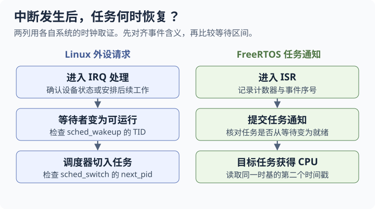

# V861 · 双核调度与设备中断

**第 35–36 周。** 用一次短时间的外设活动，回答两个问题：哪个 CPU 处理了中断，等待它的任务随后在哪个 CPU 上运行？

## 建立可比较的基线

全志 V861 产品页以 V861M3-XXX 为例，列出双核玄铁 C907、一个 E907 MCU 和 Tina Linux。Avaota F2 的工具链说明将 C907 与 Linux、E907 与 FreeRTOS 对应起来，同时列出多种应用核编译配置。记录实际板号、SDK 提交或发行包、工具链版本和 `-march`、`-mabi` 选项。采集的 ELF 和镜像要来自同一次构建。[全志 V861 产品规格](https://www.allwinnertech.com/index.php?a=index&c=product&id=148) · [Avaota F2 SDK 工具链](https://vision.100ask.net/docs/v861-AvaotaF2/software/toolchains/)

## 第 35 周先核对 ABI

在构建主机上对 SDK 生成的一个 Linux 用户程序运行 `readelf -h -A ./程序名`。记录 ELF Class、Machine、Flags 和可用的 RISC-V attributes，对照工具链所用 `-march` 和 `-mabi`。内核配置另外从 SDK 构建目录取得。用户程序的指针宽度、内核位宽和地址转换模式分别填写。若资料中列有 RV32、RV64 或厂商混合模式，逐项核实实际选择的配置。[Avaota F2 架构配置说明](https://vision.100ask.net/docs/v861-AvaotaF2/software/sys-arch-info/)

## 核对在线 CPU 和调度位置

在 Tina Linux 上读 `/sys/devices/system/cpu/online`、`/proc/cpuinfo` 和 `/proc/self/status` 中的 `Cpus_allowed_list`。分别记下得到的逻辑 CPU 编号、当前进程能使用的 CPU，以及 E907 固件来源。再看 `/proc/interrupts` 表头，核对每个计数列属于哪个 Linux CPU。

有两个可用 CPU 且板上提供 `taskset` 时，用它将同一个短时用户程序依次固定到两个可用编号。记录 `taskset -pc PID`（若工具支持）或 `/proc/PID/status` 的允许列表。启用调度跟踪的镜像还可用 `sched_switch` 事件核对实际运行的 CPU。亲和性掩码表明任务可以被放在哪里，跟踪记录能表明它在某个时刻实际在哪里运行。

只观察到一个在线 CPU 时，先查启动参数、板级 DT 中的 CPU 节点及内核的 SMP 配置，并保留原始输出。此配置仍能完成下一周的 IRQ 取证。

## 动手检查一个任务能去哪颗核

先确认在线列表包含 1，自己进程的允许列表也包含 1，且板上 `taskset` 支持 `-c`。将下面几行放在同一终端执行。后台任务会在 10 秒后自行结束。

```sh
# 在 CPU 1 在线且当前任务允许使用时，将一个短时后台任务的亲和性限制到该 CPU。
taskset -c 1 sleep 10 &
# 保存刚启动的任务号，在它退出前查允许的 CPU 列表。
p=$!
grep -E '^(Name|Pid|Cpus_allowed_list):' "/proc/$p/status"
# 等本次后台任务结束。Cpus_allowed_list 表示允许运行的范围。
wait "$p"
```

按示例判读：假定输出 `Name: sleep`、`Pid: 218`、`Cpus_allowed_list: 1`。第一项是此时的任务名，第二项把该任务与跟踪记录配对，第三项限定它下次被调度时可运行的逻辑 CPU。这里的 1 是 Linux CPU 编号。在任务睡眠期间读取允许列表，数值也可以是 1。若要证明它曾在 CPU 1 执行，须在启动任务前开启跟踪，找到记录头为 CPU 1 且 `next_pid=218` 的 `sched_switch`。实验时替换为当次 PID。

**自测：绑核后返回“Invalid argument”，该查什么？** 先对比 `cpu/online` 和 `/proc/self/status` 的允许列表。两者的交集中可能没有 CPU 1。改选交集内编号。若所有可用编号都只指向同一个 CPU，能验证单核亲和性，多核对照等映像提供两个可用 CPU 再做。

## 第 36 周的中断实验

[](figures/irq-task.svg)

从左列开始，用 IRQ 号和 TID 对应实际事件。若驱动先提交工作队列，就在前两格之间补上工作线程。

用 [L13](lab-allwinner.md) 的静默窗口和活动窗口做对照。选板上一个能重复操作、已绑定驱动的外设。如果使用摄像头，先跑通板厂提供的采集示例，记录 sensor 型号及能重复得到的帧数，再关联设备节点、驱动、IRQ 和等待数据的任务。也可以用板上已经可重复操作的按键。

读取每 CPU 中断计数的增量。若能同时取得 `irq_handler_entry`、`sched_wakeup` 与 `sched_switch`，按时间、进程 ID 和 CPU 串起来。没有串联三者的证据时，分别写下已观测的中断和任务位置，并指出中间缺哪一个事件。

## 验收

交付两份同长度窗口的记录和一张按 CPU 分列的小图。解释为什么将采集程序绑定到某个 CPU 后，设备中断仍可能由另一个 CPU 处理。给出延迟较大的两个可能原因，并提出能区分它们的一项补充观测。

继续阅读 [F101 的实时任务](platform-f101.md)，比较一次中断唤醒任务的 Linux 路径与 FreeRTOS 路径。
