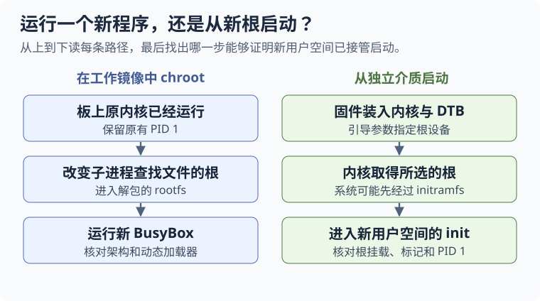

# Armbian 起步与 Buildroot 板级开发

第一次在 RK3576 跑程序，优先使用板厂已验证的镜像。如果具体板型有成熟的 Armbian 镜像，也可用它安装编译器、strace 和调试工具。先保存能工作的串口日志、内核版本、设备树与测试程序，作为后续对照。[Armbian 板级文档](https://docs.armbian.com/)

## 从启动产物理解分工

| 产物 | 本轮要回答的问题 |
| --- | --- |
| 固件和引导程序 | 板子从哪个介质启动，谁选择内核、DTB 和根文件系统？ |
| 内核 Image 与 DTB | CPU 架构、驱动和板级资源如何对应？ |
| 根文件系统 | 内核找到的第一个用户进程是什么，控制台和工具由谁提供？ |
| 工具链与 sysroot | 新程序的架构、ABI 和动态加载器怎样匹配目标系统？ |

Buildroot 可以构建工具链、根文件系统，并按配置构建内核和引导程序。第一次只构建用户空间；板级引导继续使用已验证的 BSP。需要 MPP、无线或其他板厂组件时，单列其驱动、固件、库及版本。[Buildroot 用户手册](https://buildroot.org/downloads/manual/manual.html)

## 分三次改变系统

[](figures/boot-roots.svg)

对照底部两种结果。BusyBox 能执行验证了用户空间兼容性；独立启动还需要根挂载和 init 的证据。

1. 在工作镜像上运行 [L01](lab-pid.md)，记录登录、PID 1、设备与运行结果。
2. 完成 [L11](lab-rootfs.md)。保留已知可启动的内核和 DTB，先在相同架构下用单独目录验证新用户空间，再按本板启动文档验证独立介质。
3. 固定根文件系统，改一个可观察的内核配置或 DT 属性。重新记录配置差异、串口输出和驱动绑定，解释变化发生在哪一层。

## 读一次从内核到用户空间的交接

根文件系统（rootfs）保存 `/sbin/init`、库和命令等文件。引导程序把内核、硬件描述和启动参数交给 Linux；Linux 建立设备并找到根文件系统，再启动第一个用户进程。使用 initramfs 的系统可能先执行早期用户空间的 `/init`，再切换到最终的根。进入工作镜像后，用以下只读命令找出这几个环节在本机留下的证据。

```sh
cat /proc/cmdline
awk '$2 == "/" {print $1, $3}' /proc/mounts
readlink /proc/1/exe
uname -r
```

第一行找 `root=` 或与 initramfs 有关的参数，第二行读当前挂载到 `/` 的来源和文件系统类型，第三行看现在的 PID 1 指向什么，第四行记录内核 release。例如 `/` 来自一个 ext4 分区而 PID 1 指向 systemd，说明当前用户空间用了那个文件系统和 init；它们无法单独确定之前是否经过了 initramfs。

**把 BusyBox 放进新目录并 chroot 成功，为什么仍会看到旧内核版本？** `chroot` 改变所选进程路径查找的根。它继续向同一个正在运行的内核发系统调用，所以 `uname` 结果可以完全相同。

**替换 rootfs 后某个媒体样例打不开设备，该从哪里查？** 先对照工作镜像上的设备节点和驱动绑定，再看新根目录里用户库、固件、模块和设备节点如何提供。如果内核已经启动且 shell 能运行，可以先定位到设备或用户空间依赖，不必重新从 Boot ROM 开始猜。

## 怎样让同事重新构建

保存 Buildroot 版本、最小 defconfig、rootfs overlay 和生成命令。配置成熟后，可将板级文件和自定义包组织到 `BR2_EXTERNAL` 树。交付物包括镜像校验和、构建依赖、目标板型及硬件版本。每个尚需二进制固件的步骤注明来源和版本。
